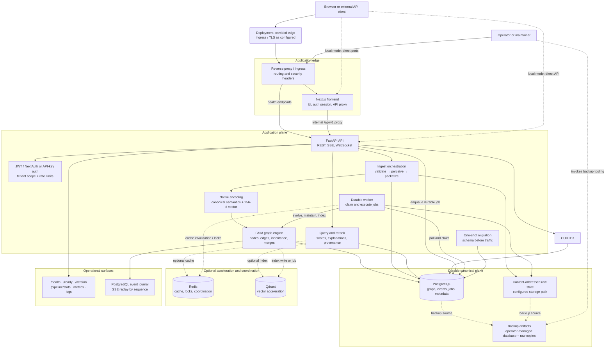
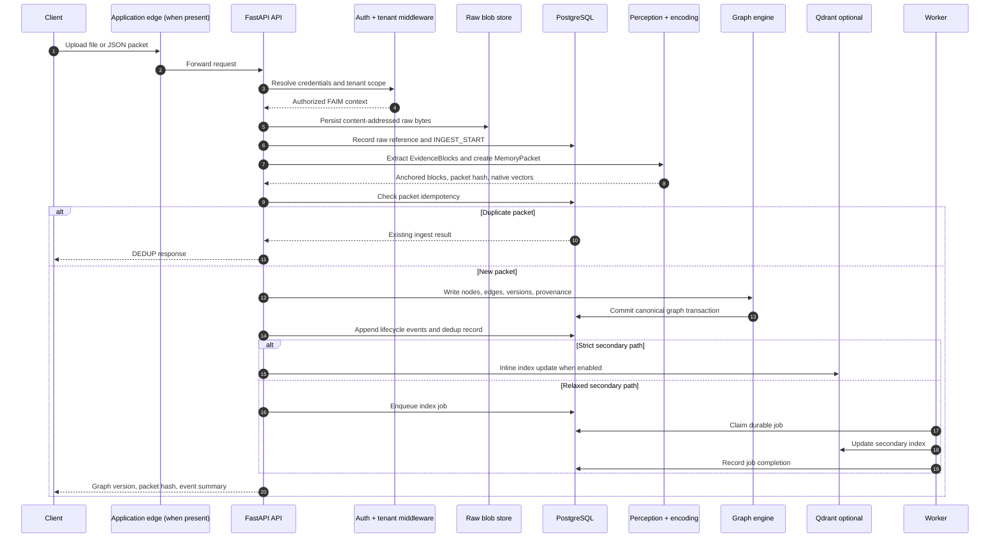
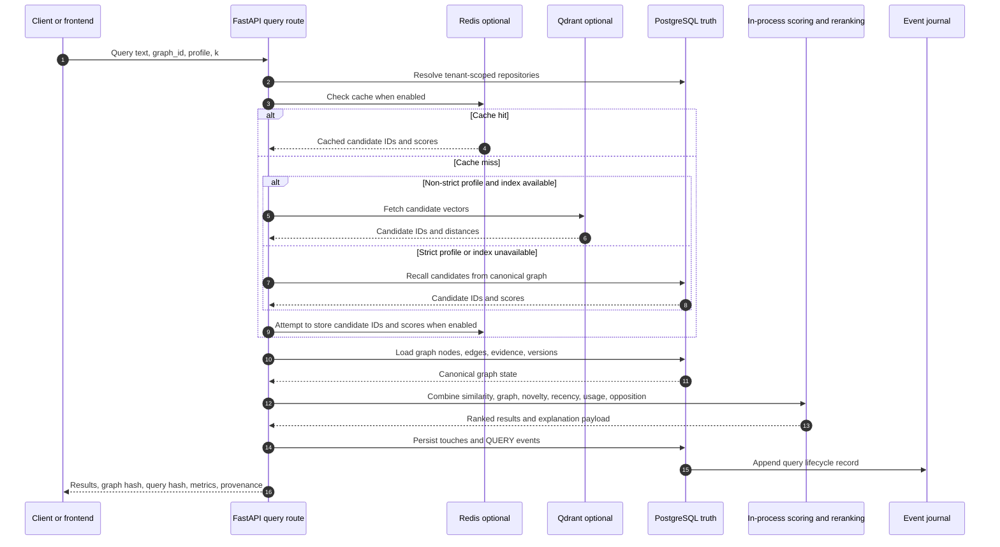
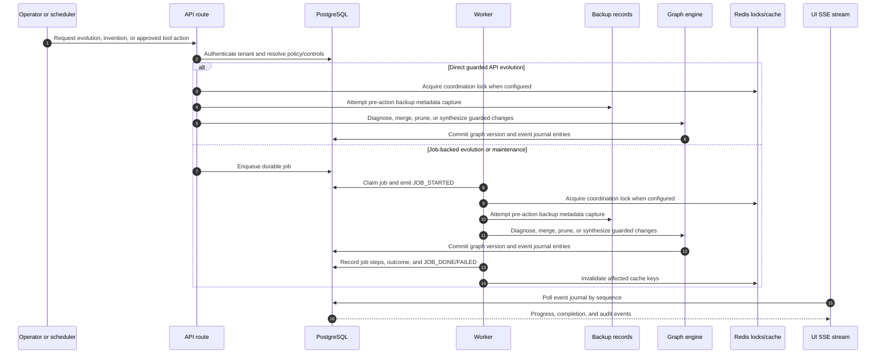
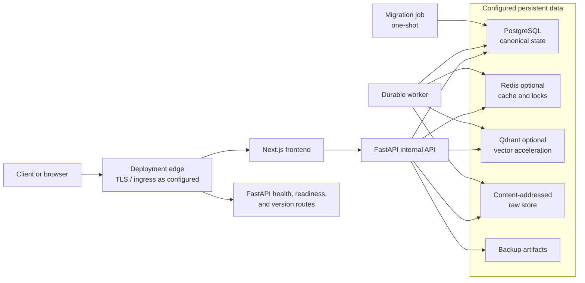

# FAIM-Native

<p align="center">
  
</p>

<p align="center">
  <strong>Fractal Antisymmetric Inheritance Memory</strong><br />
  A native-first memory graph engine for durable, explainable retrieval and agent systems.
</p>

<p align="center">
  <em>Raw evidence → structured memory → controlled graph evolution → auditable retrieval</em>
</p>

<table align="center">
  <tr>
    <td align="center"><strong>Latest version</strong><br />v0.10.0</td>
    <td align="center"><strong>Runtime</strong><br />Docker Compose (CPU / GPU)</td>
    <td align="center"><strong>Interfaces</strong><br />REST · MCP · SSE</td>
    <td align="center"><strong>Canonical data</strong><br />PostgreSQL</td>
  </tr>
</table>

> **Deployment posture:** FAIM-Native runs as a single hardened Docker Compose stack (`v0.10.0`) with unified `.env` configuration supporting both CPU-only VPS and CUDA GPU hosts. Before serving live traffic, provision environment-specific secrets and TLS, run database migrations, and verify `/health`, `/ready`, `/version`, and backup/restore procedures on the target host.

FAIM-Native turns documents, events, and multimodal evidence into a durable memory graph. It combines a FastAPI API, deterministic perception and encoding, graph-native operators, PostgreSQL persistence, optional Redis/Qdrant acceleration, durable background jobs, a Next.js workspace, MCP access, and a public black-box benchmark harness.

### Verification snapshot

The current local checkout has been exercised against the real Docker stack: API, worker, PostgreSQL, Redis, Qdrant, and frontend. Health/readiness, migrations, authenticated storage/providers/events/graph/evolution surfaces, MCP, live ingest/query, and the benchmark harness have been smoke-tested. The latest backend run recorded **1010 passed, 1 skipped**; the public harness recorded **4 passed**. Browser E2E was not claimed when the browser host was unavailable. Published competitor numbers below are external references from their own reports, not reproduced scores from the FAIM run.

The project explores an alternative memory architecture in which raw evidence remains addressable, derived knowledge is represented as a versioned graph, retrieval includes graph context and explanations, and memory evolution is treated as a controlled lifecycle. This is a research direction and engineering hypothesis, not a claim of universal novelty, priority, or superiority over vector search, RAG, knowledge graphs, agent-memory systems, or any other approach. See [Research positioning](faim_native/Docs/14-research/04-research-positioning.md) for the comparison and evaluation discipline.

## Why FAIM-Native

Most retrieval systems stop at “embed, search, return chunks.” FAIM-Native keeps the whole memory lifecycle visible:

- raw inputs are stored as SHA-256-addressed blobs, with explicit retention controls governing deletion;
- extracted evidence keeps anchors and provenance;
- deterministic vectors and semantic representations become graph nodes;
- graph writes emit events and advance a graph version;
- retrieval returns scores, evidence, graph metrics, and optional explanations;
- evolution can diagnose redundancy, invent macro nodes, learn from outcomes, and restore from backups;
- the UI can observe the same graph, event stream, metrics, storage, provider, and evolution surfaces exposed by the API.

The result is a memory substrate designed for systems that need continuity, auditability, tenant isolation, and controlled evolution, rather than only a similarity endpoint.

## End-to-end system

The following is the current implemented logical topology, based on the Compose services, FastAPI application, runtime context, ingest/query flows, and durable worker. It separates the deployment-provided edge, application services, canonical data, and optional acceleration paths without assuming a particular host, domain, or gateway.



> **Accuracy boundary:** The current Compose stack does not deploy Kafka, Kubernetes, an external object store, Prometheus, a service mesh, or a mandatory hosted LLM. OCR and embedding-provider adapters exist as optional integration paths. PostgreSQL is the authoritative state; Redis and Qdrant are not independent sources of truth. Public ingress, TLS termination, domains, and host-specific gateways are deployment concerns and are intentionally not specified here.

### The real lifecycle in plain language

1. **Reach the edge.** A deployment-provided reverse proxy or ingress may terminate TLS, route normal traffic to Next.js, and route health endpoints to FastAPI. In local Compose mode, the frontend and API can be reached directly on their mapped ports.
2. **Authenticate the request.** FastAPI middleware resolves a JWT/NextAuth session or API key, normalizes tenant scope, applies request IDs/rate limits/security headers, and passes a repository context to the route.
3. **Accept and preserve input.** Ingest validates JSON or multipart content, writes the raw payload to the raw store, records metadata/audit events in PostgreSQL, and computes a content/packet identity for idempotent retry handling.
4. **Perceive and encode.** The native extractor creates ordered `EvidenceBlock` records with anchors. Packet validation and canonicalization run before deterministic native encoding; optional OCR or embedding providers enrich the path when configured.
5. **Commit canonical graph state.** The graph engine writes nodes, edges, versions, provenance, and lifecycle events to PostgreSQL. This is the durable write boundary.
6. **Handle secondary acceleration.** Depending on profile and flags, Qdrant is updated inline, queued as a durable PostgreSQL job, or skipped. Redis may cache query candidates and coordinate locks; neither replaces PostgreSQL.
7. **Process background work.** The worker polls and claims rows from the PostgreSQL `jobs` table. It executes secondary indexing, evolution, invention, maintenance, retention, re-encryption, and related workflows, recording job events and outcomes.
8. **Query and explain.** Query reads canonical graph state, optionally consults Redis/Qdrant, calculates graph-aware scores, records touches/events, and returns ranked nodes with hashes, metrics, evidence anchors, and explanations.
9. **Stream state changes.** The SSE endpoint replays the PostgreSQL event journal by sequence number. The frontend can resume from its last sequence and receive progress, completion, job, and evolution events.
10. **Operate and recover.** Readiness checks database connectivity, required tables, and migration state. Operators use snapshots, backup/restore, audit events, logs, and smoke checks to validate or recover a deployment.

### Ingest sequence: request to durable memory



### Query and explanation sequence



### Evolution and control sequence

Manual `POST /api/v1/evolve` runs a guarded cycle directly in the API process. Scheduled and job-backed evolution, invention, indexing, and maintenance use the durable worker path shown below.



### Runtime topology (deployment-neutral)



The public edge is intentionally deployment-neutral. The repository does not require a particular DNS name, TLS provider, reverse proxy, host address, or gateway layout. Keep credentials, host-specific compose overrides, and operator runbooks outside public architecture diagrams.

For the component inventory, failure behavior, local-versus-hosted differences, and known boundaries, see [the canonical architecture guide](faim_native/Docs/01-architecture/01-end-to-end-architecture.md).

## Capabilities

### Native memory and retrieval

- deterministic text normalization, entity aliases, stemming, synonym expansion, and multilingual lexical tooling;
- fixed 256-dimensional `v_native` contract with SHA-256 vector hashes;
- graph nodes, edges, inheritance fractions, opposition signatures, versions, snapshots, and replayable events;
- strict, fast, and relaxed execution profiles where supported;
- query explain payloads with score components, evidence, parents, and recent events;
- representation V2, canonical semantics, multilingual semantics, modality sidecars, and domain knowledge surfaces;
- multi-hop **Typed Relational Concept Graph** (`Causes`, `HasPrerequisite`, `PartOf`, `UsedFor`, `RelatedTo`), corpus-learned **PPMI / 2nd-order co-occurrence bridges** (`worker-evolve`), async Redis **Query-to-Evidence Reinforcement Learning (QRL)**, **Concept-Expanded MaxSim**, and **Concept-aware Stage-1 BM25+**;
- GPU-first / automatic CPU-fallback (`FAIM_EMBEDDING_DEVICE=auto`, proactive `FAIM_MIN_CUDA_FREE_MIB` VRAM OOM guard), HMAC verified-key caching, and single-flight `GraphIndexArtifacts` RAM caching.

### Durable ingestion and multimodal evidence

- JSON base64 ingestion and multipart upload ingestion;
- content-addressed raw storage with deduplication and provenance; explicit retention controls govern deletion;
- PDF, DOCX, PPTX, XLSX, text, image, and related extraction paths represented in the core contracts;
- OCR provider registry with PaddleOCR, Tesseract, EasyOCR, and custom-provider integration points;
- durable upload jobs, cancellation, retry, re-ingestion, maintenance history, retention, and raw-file re-encryption flows.

### Evolution and agent workflows

- manual and guarded automated evolution controls;
- self-invention and macro-node proposals from coactivation evidence;
- evolution metrics, learning state, outcomes, theories, backups, and restore operations;
- domain overview, graph surface, neighborhood, path explanation, and semantic graph inspection APIs.

### Operations and security

- PostgreSQL as the canonical source of truth;
- Redis-backed caching and locks, with PostgreSQL-backed durable job coordination;
- Qdrant-backed vector acceleration with native fallback paths;
- versioned migrations with readiness checks for database connectivity, required tables, and applied schema version;
- JWT/NextAuth integration and tenant-scoped API keys;
- scoped key management, rotation and revocation, audit events, rate limiting, request IDs, security headers, log redaction, encrypted raw storage, and container hardening;
- benchmark, stress, telemetry, backup/restore, and smoke-test tooling.

## Repository map

| Path | Responsibility |
| --- | --- |
| [`faim_native/api`](faim_native/api) | FastAPI application, routers, contracts, middleware, services, and validators |
| [`faim_native/core`](faim_native/core) | Graph engine, query scoring, reasoning, operators, learning, and metrics |
| [`faim_native/perception`](faim_native/perception) | File extraction, OCR, packetization, and evidence validation |
| [`faim_native/encoding`](faim_native/encoding) | Native vectors, semantic signatures, layout, modality, and embedding-provider adapters |
| [`faim_native/lexical`](faim_native/lexical) | Unicode normalization, canonicalization, multilingual lexicons, aliases, and phrase patterns |
| [`faim_native/orchestration`](faim_native/orchestration) | Ingest/query/evolve flows, background jobs, rebuilds, and performance work |
| [`faim_native/store`](faim_native/store) | PostgreSQL repositories, migrations, raw blobs, crypto, journal, and persistence contracts |
| [`faim_native/index`](faim_native/index) | Qdrant index, deterministic ANN, inverted index, collections, and index wiring |
| [`faim-benchmarks`](faim-benchmarks) | Standalone public black-box benchmarks for FAIM, BM25, and configured external memory systems |
| [`frontend`](frontend) | Next.js dashboard, marketing/docs surfaces, authentication, graph views, and tests |
| [`scripts`](scripts) | Local demos, verification, smoke tests, backup/restore, deployment, and security automation |
| [`faim_native/Docs`](faim_native/Docs) | Canonical API, architecture, operations, security, benchmark, and implementation documentation |

## Public benchmarking

The standalone [`faim-benchmarks`](faim-benchmarks) package is the public comparison
harness. It calls FAIM only through its HTTP API, uses the same locked dataset split
and scorer for every configured adapter, skips systems without credentials, and
writes integrity-hashed JSON plus Markdown reports.

```bash
cd faim-benchmarks
python -m pip install -e ".[datasets,dev]"
cp .env.example .env
pytest -q
faim-bench beir --dataset scifact --max-queries 100 --out-dir results
```

Set `FAIM_BASE_URL` plus either `FAIM_API_KEY`/`FAIM_TENANT_ID` or
`FAIM_BEARER_TOKEN` before a live run. Competitor keys are optional; an unconfigured
adapter is recorded as `skipped`, never as a fabricated score. Do not publish a
report until the JSON integrity hash, dataset identity, seed, and completed-system
statuses have been reviewed.

### Latest complete external runs (`2026-11-24`, `Publication gate: READY`)

The latest verified runs evaluate full un-sampled splits across three official BeIR benchmarks plus conversational memory (`LoCoMo`) with pinned Hugging Face revisions, isolated `worker-ingest` / `worker-evolve` pools, HMAC verified-key caching, and `graph_version`-cached metadata:

1. **BeIR/SciFact** (**5,183 corpus documents / 300 test queries**, corpus/queries `b3b5335604bf5ee3c4447671af975ea25143d4f5`, qrels `2938d17dc3b09882fdb8c12bbbe2e2dc0e75a029`).
2. **BeIR/NFCorpus** (**3,633 corpus documents / 323 test queries**, corpus/queries `b5026a0e96e8a7ac4f95f482a596389289d46269`, qrels `a451b3b26d3ae1358f259c1a3a4dd61fcea35a65`).
3. **BeIR/ArguAna** (**8,674 corpus documents / 1,406 test queries**).
4. **LoCoMo** (long-horizon conversational memory QA).

| Runtime Profile / System | Dataset / protocol | Recall@5 | nDCG@10 | MRR | MAP | Query p50 | Status |
| --- | --- | ---: | ---: | ---: | ---: | ---: | --- |
| **FAIM Hybrid (Granite 97M, GPU)** | SciFact, 5,183 docs / 300 queries | **0.7704** | **0.6900** | **0.6590** | **0.6483** | 140.17 ms | Completed (`READY`) |
| **FAIM-Pure (Zero-ML, CPU)** | SciFact, 5,183 docs / 300 queries | 0.7554 | 0.6871 | 0.6564 | 0.6459 | **86.31 ms** (CI) / 100.22 ms | Completed (`READY`) |
| **Granite 97M R2 alone (GPU)** | SciFact standalone baseline | 0.7522 | 0.6806 | 0.6493 | 0.6403 | 9.81 ms (in-proc) | Baseline reference |
| **BM25 baseline** | Same full SciFact split and scorer | 0.7193 | 0.6644 | 0.6366 | 0.6242 | 45.76 ms (in-proc) | Completed (`READY`) |
| **FAIM Hybrid (Granite 97M, GPU)** | NFCorpus, 3,633 docs / 323 queries | **0.1297** | **0.3314** | **0.5290** | **0.1367** | 101.62 ms | Completed (`READY`) |
| **FAIM-Pure (Zero-ML, CPU)** | NFCorpus, 3,633 docs / 323 queries | 0.1289 | 0.3267 | 0.5259 | 0.1340 | **49.91 ms** (CI) / 66.48 ms | Completed (`READY`) |
| **BM25 baseline** | Same full NFCorpus split and scorer | 0.1205 | 0.3110 | 0.5211 | 0.1294 | 3.32 ms (in-proc) | Completed (`READY`) |
| **FAIM Hybrid (Granite 97M, GPU)** | ArguAna, 8,674 docs / 1,406 queries | 0.5096 | 0.3387 (`R@10 0.7266`) | 0.2279 | 0.2279 | **304.55 ms** | Completed (`READY`) |
| **BM25 baseline** | Same full ArguAna split and scorer | 0.5275 | 0.3451 (`R@10 0.7216`) | 0.2349 | 0.2349 | 567.83 ms (in-proc) | Completed (`READY`) |
| **FAIM Hybrid (Granite 97M, GPU)** | LoCoMo conversational memory | `0.0710 Fact Recall` | `0.0582 Token F1` | - | - | 234.56 ms | Completed (`READY`) |
| **FAIM-Native (v17 historical CPU)** | SciFact, 5,183 docs / 300 queries | 0.4831 | 0.4184 | 0.3908 | 0.3798 | 7,195.68 ms | Superseded |
| **FAIM-Native (v9 historical CPU)** | SciFact, 5,183 docs / 300 queries | 0.0539 | 0.0517 | - | - | 17,373.00 ms | Superseded |

See [**BENCHMARKS.md**](BENCHMARKS.md) for the complete cross-engine comparison, `FAST` vs `BALANCED` ablation, LoCoMo per-category breakdown, historical progression (`v9` to `v0.10.0`), and all signed artifact hashes.

Evidence artifacts:

- [`BENCHMARKS.md`](BENCHMARKS.md) (root benchmark overview and progression summary)
- [`03-multi-scenario-benchmark-results-2026-11-24.md`](faim_native/Docs/13-benchmarks/03-multi-scenario-benchmark-results-2026-11-24.md) (`2026-11-24` evaluation report)
- [`COMPARISON.md`](faim-benchmarks/results/COMPARISON.md) · [`RESULTS.md`](faim-benchmarks/results/RESULTS.md) (signed JSON/Markdown artifact index)

### Public competitor references (not directly comparable)

The following are published vendor or paper results on **different datasets,
tasks, answer models, and metrics**. They are included for context only; they
are not merged into the SciFact table and were not reproduced by FAIM's harness.

| System | Public benchmark and published result | Comparability note |
| --- | --- | --- |
| Mem0 | LoCoMo: **92.5** overall across 1,540 questions; Mem0 also reports 94.4 on LongMemEval and 64.1 on BEAM-1M | Conversational memory / judge-based evaluation, not document retrieval; vendor-reported. [Mem0 Research](https://mem0.ai/research) |
| Zep / Graphiti | DMR: **94.8%** versus MemGPT 93.4%; the paper also reports up to 18.5% accuracy improvement on LongMemEval | Different memory benchmark and protocol; the paper's “up to” result is not a single SciFact-equivalent score. [Zep paper](https://arxiv.org/abs/2501.13956) |
| Supermemory | LongMemEval-S: **97% Recall@20** across 500 questions; published comparison includes Zep 71.2% and full-context 60.2% | Different dataset, aggregation, and GPT-4o judging; vendor-reported. [Supermemory Research](https://supermemory.ai/research/) |
| Letta | Letta publishes Context-Bench V2 and a model-oriented agent-memory leaderboard, but no single directly comparable SciFact retrieval score | Keep separate until FAIM runs the same public protocol. [Context-Bench V2](https://www.letta.com/blog/evaluating-memory-in-production-agents/) · [Letta Leaderboard](https://www.letta.com/blog/letta-leaderboard/) |

These references do **not** establish that FAIM beats or loses to each vendor
on their own task. A fair head-to-head comparison requires one locked public
dataset, identical query set, scorer, answer model, top-k, indexing policy,
hardware budget, and published raw results for every system.

## Quick start with Docker

The supported evaluation path is the real multi-container application, not a mocked API. Run the Compose stack, wait for readiness, then exercise an authenticated ingest and query before evaluating features.

### Prerequisites

- Docker Engine with Compose v2
- Node.js and npm for the root command wrapper
- Python 3.11 for local tests and scripts

### 1. Configure the stack

```bash
cp .env.example .env
```

Replace every `CHANGE_ME_*` value in `.env`. The default Compose stack expects secrets for PostgreSQL, Redis, Qdrant, and NextAuth. Keep `.env` local and never commit it.

### 2. Start the full stack

```bash
docker compose config --quiet
docker compose up -d --build
npm run faim:ps
```

The default Compose topology contains:

| Service | Local address | Role |
| --- | --- | --- |
| API | `http://localhost:8000` | FastAPI memory graph API |
| Frontend | `http://localhost:8010` | Next.js workspace and docs portal |
| PostgreSQL | `localhost:8020` | Canonical relational store with pgvector image |
| Redis | `localhost:8030` | Cache, locks, and job coordination |
| Qdrant | `localhost:8040` / gRPC `8050` | Vector acceleration |
| Worker | no public port | Polls PostgreSQL jobs and runs background workflows |
| Migrate | one-shot container | Applies explicit schema migrations before traffic |

The `migrate` service is a one-shot migration job. The API's `FAIM_AUTO_MIGRATE` default is intentionally `false`; use the explicit migration service or your deployment runbook so schema changes stay visible.

### 3. Verify liveness and readiness

```bash
curl -fsS http://localhost:8000/health
curl -fsS http://localhost:8000/ready
curl -fsS http://localhost:8000/version
docker compose ps
```

Continue only when the API and worker report `healthy`, readiness reports connected dependencies and matching migrations, and the migration service has completed successfully.

Open these surfaces after the checks pass:

- API documentation: [`http://localhost:8000/docs`](http://localhost:8000/docs)
- ReDoc: [`http://localhost:8000/redoc`](http://localhost:8000/redoc)
- Frontend: [`http://localhost:8010`](http://localhost:8010)
- Frontend docs portal: [`http://localhost:8010/docs`](http://localhost:8010/docs)

### Useful lifecycle commands

```bash
npm run faim:logs       # Follow service logs
npm run faim:ps         # Show service state
npm run faim:down       # Stop the stack
npm run faim:update     # Fast-forward pull and rebuild
npm run faim:accel:up   # Start the acceleration profile when configured
```

### 4. Run the end-to-end Docker smoke path

After configuring a tenant-scoped API key, run the protected ingest/query flow below. Then verify the event journal, graph surface, storage backend health, evolution status, provider registry, and authenticated MCP endpoint. The same sequence is used for release verification; a passing unit suite alone is not a Docker release check.

## Run a real ingest and query

The protected API accepts either database-backed API keys or a compatible environment-key configuration. For a local integration shell, set credentials that match your `.env`:

```bash
export FAIM_TENANT_ID=default
export FAIM_API_KEY='replace-with-your-local-key'
export FAIM_GRAPH_ID='demo-graph'
```

Ingest a file:

```bash
curl -fsS -X POST http://localhost:8000/api/v1/ingest/upload \
  -H "X-Tenant-Id: ${FAIM_TENANT_ID}" \
  -H "X-Api-Key: ${FAIM_API_KEY}" \
  -F "graph_id=${FAIM_GRAPH_ID}" \
  -F "profile=strict" \
  -F "persist_mode=strict" \
  -F "file=@./sample.txt"
```

Query the graph:

```bash
curl -fsS -X POST http://localhost:8000/api/v1/query \
  -H "Content-Type: application/json" \
  -H "X-Tenant-Id: ${FAIM_TENANT_ID}" \
  -H "X-Api-Key: ${FAIM_API_KEY}" \
  -d '{
    "graph_id": "demo-graph",
    "query_text": "What should I remember from this document?",
    "k": 10,
    "profile": "STRICT",
    "return_explain": true
  }'
```

The response includes the graph version, query hash, ranked nodes, score components, evidence anchors, graph metrics, and optional direct-answer/provenance fields.

## API surface

The FastAPI app mounts the current versioned API under `/api/v1`.

| Area | Representative routes |
| --- | --- |
| Health | `GET /health`, `GET /ready`, `GET /version`, `GET /pipeline/stats` |
| Auth | `POST /api/v1/auth/otp/request`, `POST /api/v1/auth/otp/verify`, TOTP and account routes |
| Memory | `POST /api/v1/memory/search`, `POST /api/v1/memory/write`, memory lifecycle routes |
| Ingest | `POST /api/v1/ingest`, `POST /api/v1/ingest/upload` |
| Query | `POST /api/v1/query` |
| Graph | `/api/v1/graph/surface`, `/api/v1/graph/neighborhood`, `/api/v1/graph/paths/explain` |
| Nodes | `/api/v1/node/{node_id}`, `/api/v1/node/{node_id}/explain` |
| Events | `/api/v1/events`, `/api/v1/events/latest`, `/api/v1/events/stream` |
| Evolution | `/api/v1/evolve`, status, control, invention, backups, learning, and metrics |
| Storage | uploads, files, provenance, maintenance, retention, crypto rotation, and backend health |
| Benchmarks | benchmark runs, stress tests, alerts, golden signals, export, and publication suite |

For request and response contracts, start with the [canonical API documentation](faim_native/Docs/02-api/01-api-documentation.md). The generated OpenAPI document at `/openapi.json` is the runtime source of truth.

## Native design principles

| Principle | Meaning in FAIM-Native |
| --- | --- |
| Raw source is addressable | Source bytes are content-addressed with SHA-256 and retained separately from derived graph state; explicit retention may delete them |
| PostgreSQL is canonical | Relational metadata, graph state, events, versions, and operational records have a durable source of truth |
| Evidence stays addressable | Blocks carry deterministic ordering and anchors back to their raw source |
| Core determinism is explicit | Canonical JSON, stable hashes, fixed vector dimensions, and strict profiles make replay and comparison possible for fixed inputs and configuration |
| Evolution is controlled | Guardrails, intervals, action limits, diagnostics, backups, and restore APIs bound automated change |
| Tenant scope is explicit | Auth context, repositories, graph reads, event streams, and storage paths carry tenant scope; deployments must verify isolation |
| Acceleration is secondary | Redis and Qdrant improve speed or coordination; the durable graph remains authoritative |
| Mutations are observable | Ingest, query, evolution, storage, and diagnostics flows emit structured events or audit records where the selected path supports them |

## Configuration highlights

The main configuration surface is [`faim_native/runtime/config.py`](faim_native/runtime/config.py), with deployment examples in [`deploy`](deploy) and [`.env.example`](.env.example).

Important controls include:

- `DATABASE_URL`, `REDIS_URL`, `QDRANT_URL`, and `QDRANT_API_KEY` for data-plane services;
- `FAIM_AUTO_MIGRATE` for explicit migration behavior;
- `FAIM_ENABLE_CACHE`, `FAIM_ENABLE_INDEX`, and `FAIM_ENABLE_JOBS` for acceleration and background work;
- `FAIM_OCR_ENABLED`, `FAIM_OCR_ENGINE`, and `FAIM_OCR_FAIL_CLOSED` for OCR behavior;
- `FAIM_SELF_EVOLVE_ENABLED`, `FAIM_SELF_EVOLVE_TRIGGER_MODE`, and action/interval limits for evolution;
- `FAIM_SELF_INVENT_ENABLED` and invention thresholds for macro-node synthesis;
- `FAIM_ENCRYPTION_AT_REST`, `FAIM_ENCRYPTION_FAIL_CLOSED`, `FAIM_STORAGE_CONTRACT_STRICT`, and auth fallback switches for security posture;
- `FAIM_RATE_LIMITS_JSON`, payload limits, CORS, public origin, and CSP settings for edge behavior;
- `FAIM_API_WORKERS`, `FAIM_INGEST_WORKERS`, `FAIM_CONTAINER_RUNTIME` (`runc` on CPU VPS, `nvidia` on CUDA GPU), `FAIM_EMBEDDING_DEVICE` (`cpu` / `auto`), `FAIM_CPU_THREADS`, `FAIM_MIN_CUDA_FREE_MIB`, `FAIM_FAST_ML_EMBEDDING=auto` (English `FAST` via FAIM-Pure, non-English and `STRICT`/`BALANCED`/`RELAXED` via Granite 97M), and fail-open `FAIM_EMBEDDING_PREWARM_REQUIRED=false` (see [GPU passthrough, fallback & worker sizing](faim_native/Docs/10-operations/06-gpu-passthrough-and-auth-caching.md)).

Production deployments should begin with the restrictive values in [`.env.example`](.env.example), then make every relaxation deliberate and documented.

## Local development and verification

Install Python dependencies, then run the repository test suite:

```bash
python3.11 -m venv .venv
source .venv/bin/activate
python -m pip install -r requirements.txt
pytest -q
```

Run the frontend checks from `frontend/`:

```bash
cd frontend
npm ci
npm run typecheck
npm run test:unit
npm run test:e2e
```

From the repository root, the convenience checks are:

```bash
npm run tsc
npm run eslint
npm run prettier
./scripts/security_audit.sh
```

Useful executable demos include:

```bash
python scripts/faim_write_demo.py ./sample.txt
python scripts/faim_diagnostics_demo.py
```

The acceptance suite covers the implemented tenant, ingest, graph, storage, evolution, benchmark, and security surfaces. Treat the output from the current checkout as the authoritative result; historical reports are archived and may contain superseded counts or commands.

## Deployment and operations

### Containerized deployment

The repository includes a hardened multi-service Compose stack and environment-specific deployment helpers. Use the operator runbook for the target environment, keep credentials and host-specific overrides outside source control, and validate `/health`, `/ready`, `/version`, logs, backups, and rollback procedures before exposing traffic.

Read the [CI, semantic releases, and deployment guide](faim_native/Docs/10-operations/07-ci-and-releases.md), the [Docker deployment guide](faim_native/Docs/10-operations/01-deployment.md), and the [operational runbook](faim_native/Docs/10-operations/03-runbook.md) before using a remote environment.

### Operational checks

```bash
curl -fsS https://your-host.example/health
curl -fsS https://your-host.example/ready
curl -fsS https://your-host.example/version
./scripts/security_audit.sh
```

Readiness is stronger than liveness: it checks database connectivity, required tables, and migration state. A service can be alive while remaining intentionally unready until schema and dependencies are correct.

## Documentation index

- [Research positioning](faim_native/Docs/14-research/04-research-positioning.md)
- [CI, semantic releases, and deployment](faim_native/Docs/10-operations/07-ci-and-releases.md)
- [Canonical documentation index](faim_native/Docs/00-readme.md)
- [End-to-end architecture and runtime boundaries](faim_native/Docs/01-architecture/01-end-to-end-architecture.md)
- [Security reporting policy](SECURITY.md)
- [Support guide](SUPPORT.md)
- [Contributing guide](CONTRIBUTING.md)
- [Governance](GOVERNANCE.md)
- [Code of conduct](CODE_OF_CONDUCT.md)
- [Changelog](CHANGELOG.md)
- [API documentation](faim_native/Docs/02-api/01-api-documentation.md)
- [Current code map](faim_native/Docs/09-implementation/01-current-code-map.md)
- [Security guide](faim_native/Docs/11-security/03-security-guide.md)
- [Threat model](faim_native/Docs/11-security/04-threat-model.md)
- [Operations and deployment](faim_native/Docs/10-operations/01-deployment.md)
- [GPU passthrough, fallback & worker sizing](faim_native/Docs/10-operations/06-gpu-passthrough-and-auth-caching.md)
- [Zero-ML retrieval, concept graph & Concept-MaxSim](faim_native/Docs/01-architecture/03-zero-ml-retrieval-and-concept-expansion.md)
- [Empirical Benchmarks Overview](BENCHMARKS.md)
- [Multi-scenario benchmark results (2026-11-24)](faim_native/Docs/13-benchmarks/03-multi-scenario-benchmark-results-2026-11-24.md)
- [Production benchmark suite (2026-11-22)](faim_native/Docs/13-benchmarks/02-production-benchmark-suite-2026-11-22.md)
- [Signed benchmark artifact ledger](faim-benchmarks/results/RESULTS.md)

## Contributing

Keep changes reviewable and preserve the native contracts. Before opening a pull request:

1. run the relevant Python and frontend tests;
2. run type, lint, formatting, and security checks that apply to the change;
3. update API or operational docs when a contract changes;
4. include migration, rollback, tenant-isolation, and provenance implications for persistence changes;
5. keep secrets, raw data, generated reports, and local runtime artifacts out of commits.

`main` is intended to remain protected; use a branch and pull request for changes.

## License

FAIM-Native source code, scripts, configuration, and code examples are licensed under the [Apache License 2.0](LICENSE).

Original documentation and non-code assets are licensed under [CC BY 4.0](LICENSE-DOCS.md). Third-party dependencies, container images, datasets, model weights, provider integrations, and user content remain under their own terms; see [`THIRD_PARTY_NOTICES.md`](THIRD_PARTY_NOTICES.md).

FAIM, FAIM-Native, FAIMATRIX, and project logos are not granted as trademarks by the software license. See [`TRADEMARKS.md`](TRADEMARKS.md).

See [`CONTRIBUTING.md`](CONTRIBUTING.md) for contribution and submission terms. This licensing setup should be reviewed by the project copyright holder or legal counsel before a public commercial launch.
