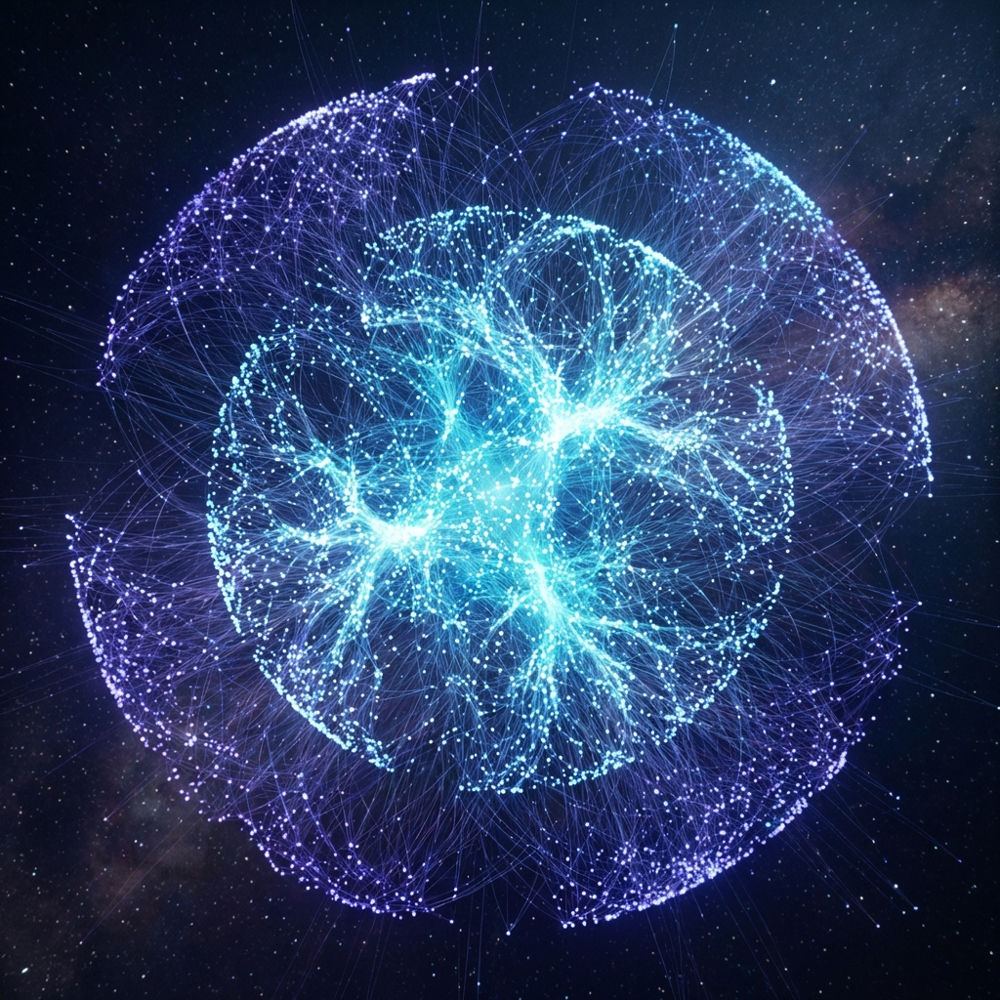

# Radial Cluster Graph Visualization

This plan outlines the transformation of the 3D Graph (FIG view) into a "Neural Galaxy" visualization based on the **top-left** design preference. The graph will feature dense, radial clusters of particle-nodes connected by faint neural filaments.

## Visual Concept (Cosmic Intelligence)

_This design represents a "Neural Galaxy" where memories are dense clusters of glowing particles forming complex, spherical structures._

## File Changes Detailed

To implement this, I will need to modify the main graph view and create several supporting utilities for the procedural geometry and shaders.

### [MODIFY] [Graph3DView.tsx](file:///home/sephi-asi/FAIM/frontend/src/components/graph/Graph3DView.tsx)

- **Integration**: Update to import the new `NeuralClusterGeometry`.
- **Node Customization**: Set `nodeThreeObject` to return the new procedural cluster groups.
- **Link Customization**: Set `linkThreeObject` to render faint, glowing neural filaments.
- **Physics Tuning**: Adjust `d3-force` parameters (alphaDecay, velocityDecay) to support the stabilization of dense clusters.

---

### [NEW] [NeuralClusterGeometry.ts](file:///home/sephi-asi/FAIM/frontend/src/components/graph/NeuralClusterGeometry.ts)

- **Procedural Logic**: A utility that generates a `THREE.Group` for each node.
- **Particle System**: Uses `THREE.Points` to create the "cluster" effect with hundreds of tiny particles per node.
- **Density Mapping**: Logic to make the center of the node brighter and denser, tapering off radially.

---

### [NEW] [NeuralClusterMaterial.ts](file:///home/sephi-asi/FAIM/frontend/src/components/graph/NeuralClusterMaterial.ts)

- **Custom Shaders**: Specialized GLSL shaders for the particles.
- **Bioluminescence**: Implements the cyan-to-violet gradient and "breathing" glow effect.
- **Performance Optimization**: Ensures thousands of particles can be rendered smoothly using GPU instancing.

## Verification Plan

### Automated Tests

- **Performance Benchmarking**: Run a stress test with 500+ memories to ensure frame rates stay above 60 FPS.
- **WebGL Audit**: Check for memory leaks or shader compilation errors.

### Manual Verification

- **Visual Accuracy**: Confirm the "Cosmic" feel matches the concept image.
- **Node Selection**: Ensure selecting a cluster still highlights it and opens the correct details panel.
- **Zoom Fluidity**: verify that zooming into a cluster reveals the intricate particle details.
