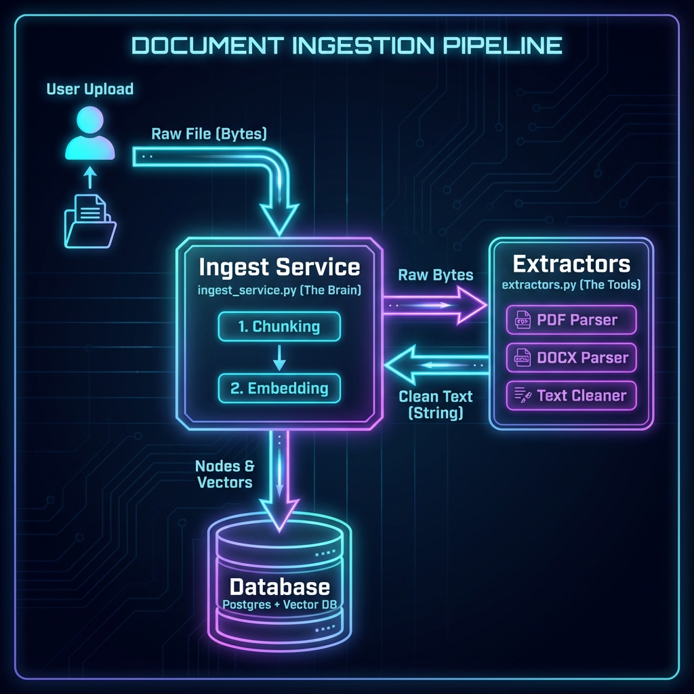

# FAIM Ingestion Pipeline Workflow

This document explains the "Digestive System" of FAIM—how raw files become intelligent memories.

## Visual Architecture

## Step-by-Step Process

### 1. The Handoff (API → Ingest Service)

- **Who:** User uploads a file (PDF, DOCX, TXT, etc.).
- **Action:** The API (`app.py`) receives the stream of bytes and passes it immediately to the **Ingest Service**.
- **State:** Data is just a "Blob" of bytes. It has no meaning yet.

### 2. The Extraction (Ingest Service ⇄ Extractor)

- **Who:** `ingest_service.py` calls `extractors.py`.
- **Action:**
  - The Service hands the raw bytes to the Extractor.
  - The Extractor identifies the file type (e.g., PyMuPDF for `.pdf`).
  - The Extractor strips away formatting, fonts, and images, keeping only the **Clean Text**.
- **Result:** The Extractor returns a plain Python string and finishes its job.

### 3. The Digestion (Ingest Service internal)

- **Chunking:** The Service cuts the long text string into smaller pieces (e.g., 500 words each) so the AI can read them easily.
- **Embedding:** The Service sends each chunk to the Embedding Model (OpenAI/Groq).
- **Result:** Text turns into **Vectors** (mathematical coordinate lists).

### 4. The Storage (Ingest Service → Database)

- **Postgres:** The original text chunks are saved as **Nodes** (for humans to read).
- **Qdrant:** The mathematical vectors are saved in the **Vector DB** (for AI to search).

### 5. Work Finished 🏁

Once the data is saved in both databases, the Ingestion Pipeline's job is **100% complete**. It does _not_ run inference, clustering, or UI updates. It essentially says: _"I have delivered the furniture. Goodbye."_
