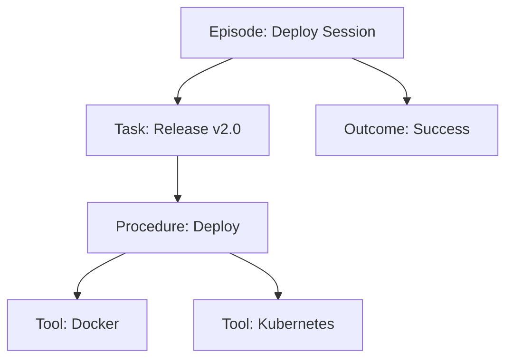

# FAIM AGI Architecture Roadmap

## P5+ Cognitive Memory System

---

**Version:** 1.0  
**Author:** Ravinder Singh  
**Date:** January 2026  
**Status:** Future Implementation Roadmap

---

## Table of Contents

1. [Executive Summary](#1-executive-summary)
2. [What Makes Memory AGI-Ready](#2-what-makes-memory-agi-ready)
3. [P5.0 — Schema & Types](#3-p50--schema--types)
4. [P5.1 — Episodic & Task Timelines](#4-p51--episodic--task-timelines)
5. [P5.2 — Procedural Memory](#5-p52--procedural-memory)
6. [P5.3 — Semantic Relations](#6-p53--semantic-relations)
7. [P5.4 — Credit Assignment & Learning](#7-p54--credit-assignment--learning)
8. [P5.5 — Retention & Privacy Policies](#8-p55--retention--privacy-policies)
9. [P5.6 — Agent-Facing API](#9-p56--agent-facing-api)
10. [Production Hardening](#10-production-hardening)
11. [Implementation Phases](#11-implementation-phases)

---

## 1. Executive Summary

FAIM (Fractal AI Memory) currently provides a world-class memory engine with:

| Completed Features                         | Status |
| ------------------------------------------ | ------ |
| Graph + Fractal Inheritance + Antisymmetry | ✅     |
| Hot VectorBank (CPU/GPU)                   | ✅     |
| Warm NodeCache                             | ✅     |
| NVMe Snapshots + Journal                   | ✅     |
| Async Write Queue + Ingest Worker          | ✅     |
| Optional GPU Backend                       | ✅     |

**This document outlines the P5+ roadmap to transform FAIM into a complete AGI-ready cognitive memory system.**

---

## 2. What Makes Memory AGI-Ready

> AGI-ready memory isn't just **where** you store stuff, but **how an agent lives in it.**

### Core Philosophy

| Traditional Memory | AGI Memory             |
| ------------------ | ---------------------- |
| Store and retrieve | Live and learn         |
| Static nodes       | Evolving episodes      |
| Flat facts         | Procedural skills      |
| Simple links       | Semantic relationships |
| No feedback        | Credit assignment      |
| No forgetting      | Intelligent pruning    |

---

## 3. P5.0 — Schema & Types

### Overview

Light semantic scaffolding for AGI reasoning without "ontology hell."

### Node Types

| Type        | Purpose                 | Example                            |
| ----------- | ----------------------- | ---------------------------------- |
| `Concept`   | Abstract ideas          | "machine learning", "optimization" |
| `Task`      | Active work items       | "deploy v2.0", "fix bug #123"      |
| `Episode`   | Time-bounded activities | "debugging session 14:32-15:05"    |
| `Procedure` | How-to knowledge        | "steps to deploy to production"    |
| `Tool`      | External systems        | "Docker", "PostgreSQL", "VSCode"   |
| `Person`    | Human actors            | "User A", "Developer B"            |
| `Document`  | Reference materials     | "API docs", "design spec"          |

### Edge Types

| Edge                 | Meaning               | Example                          |
| -------------------- | --------------------- | -------------------------------- |
| `causes`             | Causal relationship   | "action X causes result Y"       |
| `prevents`           | Blocking relationship | "condition A prevents outcome B" |
| `depends_on`         | Prerequisite          | "task X depends on task Y"       |
| `uses_tool`          | Tool usage            | "procedure uses Docker"          |
| `belongs_to_project` | Containment           | "task belongs to Project Z"      |

---

## 4. P5.1 — Episodic & Task Timelines

### Purpose

Enable agents to understand **when** things happened and **how they unfolded**.

### Episode Structure

```
Episode {
    episode_id: UUID
    start_time: Timestamp
    end_time: Timestamp
    phase: "planning" | "executing" | "reviewing"
    status: "active" | "completed" | "failed"
    outcome: String
    summary: String  # "what happened"
    reward: Float    # success score
    agent_id: String
}
```

### Task Timeline

```
Timeline [
    Episode: "Task X started at 14:32"
        → Step 1: "Analyzed requirements"
        → Step 2: "Implemented solution"
        → Step 3: "Tests failed — root cause: missing config"
    Episode: "Task X resumed at 15:10"
        → Step 3b: "Fixed config, tests passed"
]
```

### Agent Use Cases

| Query                                          | Purpose             |
| ---------------------------------------------- | ------------------- |
| "Last time we tried this, what happened?"      | Learn from history  |
| "Step 3 failed because X — do step 3b instead" | Avoid past mistakes |
| "Show me all failed episodes this week"        | Pattern recognition |

---

## 5. P5.2 — Procedural Memory

### Purpose

Store **how to do things**, not just facts.

### Procedure Node Structure

```
Procedure {
    id: UUID
    name: String
    steps: [
        { action: String, params: Dict }
    ]
    trigger_conditions: String
    success_rate: Float  # 0.0 - 1.0
    total_uses: Int
    last_used: Timestamp
    owner_agent: String
}
```

### Example: "Onboard New User"

| Step | Action                    | Parameters              |
| ---- | ------------------------- | ----------------------- |
| 1    | Send welcome email        | `{template: "welcome"}` |
| 2    | Create default workspace  | `{name: "Personal"}`    |
| 3    | Initialize sample project | `{type: "tutorial"}`    |

**Success Rate:** 8/10 times under normal conditions

### Links

| From      | To        | Relationship             |
| --------- | --------- | ------------------------ |
| Episode   | Procedure | "used procedure X"       |
| Procedure | Tool      | "uses tool Y"            |
| Procedure | Procedure | "depends on procedure Z" |

---

## 6. P5.3 — Semantic Relations

### Purpose

Enable structured queries beyond "nearest neighbors."

### Query Examples

| Natural Language                          | FAIM Query                                                    |
| ----------------------------------------- | ------------------------------------------------------------- |
| "Show me all procedures that use Tool X"  | `nodes.filter(uses_tool == "X")`                              |
| "Show me all failures where cause was Y"  | `episodes.filter(causes == "Y", status == "failed")`          |
| "What are my active tasks for project Z?" | `tasks.filter(belongs_to_project == "Z", status == "active")` |

### Graph Structure



---

## 7. P5.4 — Credit Assignment & Learning

### Purpose

Learn which memories are valuable and update accordingly.

### Feedback Record

```
FeedbackRecord {
    id: UUID
    episode_id: UUID
    used_nodes: [NodeId]
    reward: Float  # -1.0 to 1.0
    context: String
    agent_id: String
    timestamp: Timestamp
}
```

### Learning Actions

| Trigger          | Action                    |
| ---------------- | ------------------------- |
| High reward      | Increase node priority    |
| Repeated use     | Mark as "landmark" memory |
| Low reward       | Decrease importance score |
| Never used       | Candidate for compaction  |
| Conflicting info | Mark for review           |

### Sleep Mode (Offline Processing)

| Task                              | Frequency |
| --------------------------------- | --------- |
| Re-weight edges based on feedback | Nightly   |
| Mark key "landmark" memories      | Weekly    |
| Plan merges for redundant nodes   | Weekly    |
| Run antisymmetry optimization     | On-demand |

---

## 8. P5.5 — Retention & Privacy Policies

### Purpose

Managing long-running agents over years of operation.

### Soft Forgetting

| Score Range | Action                |
| ----------- | --------------------- |
| 0.8 - 1.0   | Keep in Hot tier      |
| 0.5 - 0.8   | Move to Warm tier     |
| 0.2 - 0.5   | Move to Cold tier     |
| 0.0 - 0.2   | Candidate for pruning |

### Hard Delete (Right to be Forgotten)

```
delete_user(user_id)
    → Find all nodes with owner == user_id
    → Remove nodes from all indices
    → Rebuild affected FIG portions
    → Run antisymmetry to repair graph
```

### Privacy Tags

| Tag            | Meaning               |
| -------------- | --------------------- |
| `personal`     | User-specific data    |
| `confidential` | Business-sensitive    |
| `export_safe`  | Can be exported       |
| `ephemeral`    | Auto-delete after TTL |

### Node Fields

```
NodeRecord {
    ...existing fields...
    sensitivity: "public" | "personal" | "confidential"
    owner: UUID
    retention_ttl: Duration
    policy_tags: [String]
}
```

### Periodic Jobs

| Job              | Description                  |
| ---------------- | ---------------------------- |
| Enforce TTLs     | Delete expired nodes         |
| Redact/Anonymize | Remove PII from cold storage |
| Rebuild indices  | After bulk deletes           |
| Audit logging    | Track access patterns        |

---

## 9. P5.6 — Agent-Facing API

### Purpose

High-level verbs for agents to treat FAIM as their brain.

### Episode Management

| Endpoint                        | Purpose                    |
| ------------------------------- | -------------------------- |
| `start_episode(task_id, goal)`  | Begin tracking activity    |
| `end_episode(outcome, summary)` | Close episode with results |
| `log_step(description, data)`   | Record intermediate steps  |

### Memory Operations

| Endpoint                             | Purpose                 |
| ------------------------------------ | ----------------------- |
| `remember_goal(goal, context)`       | Store current objective |
| `remember_outcome(result, reward)`   | Store what happened     |
| `commit_thought(content, refs)`      | Store reasoning trace   |
| `log_decision(choice, alternatives)` | Record decision point   |

### Context Retrieval

| Endpoint                             | Purpose                   |
| ------------------------------------ | ------------------------- |
| `load_context_for_task(task_id)`     | Get relevant memories     |
| `what_did_we_try_last_time(task_id)` | Historical context        |
| `get_procedure(name)`                | Retrieve how-to knowledge |
| `similar_episodes(query)`            | Find related past work    |

### Explainability

| Endpoint                         | Purpose                 |
| -------------------------------- | ----------------------- |
| `why_did_you_retrieve(node_ids)` | Explain retrieval logic |
| `trace_decision(decision_id)`    | Show reasoning path     |
| `provenance(node_id)`            | Show memory origin      |

---

## 10. Production Hardening

### 10.1 Observability & Debugging

#### Metrics to Track

| Metric              | Description                         |
| ------------------- | ----------------------------------- |
| Latency p50/p95/p99 | For `top_k`, `radius`, `add_memory` |
| Queue depth         | WriteQueue pending items            |
| Snapshot interval   | Time since last snapshot            |
| Cache hit rate      | HotNodeCache efficiency             |

#### Logging

| Event                 | Priority |
| --------------------- | -------- |
| Slow queries (> X ms) | Warning  |
| Snapshot events       | Info     |
| Replay events         | Info     |
| Ingest failures       | Error    |

### 10.2 Consistency Checks

| Check                              | Description        |
| ---------------------------------- | ------------------ |
| node_ids ↔ VectorBank alignment    | Index integrity    |
| No duplicate node_id rows          | Data uniqueness    |
| Snapshot + journal = current state | Replay correctness |

### 10.3 Multi-Tenant Hygiene

| Feature             | Implementation                 |
| ------------------- | ------------------------------ |
| Namespace isolation | `tenant_id:graph_id` prefix    |
| Resource limits     | Max nodes, RAM, QPS per tenant |
| Query isolation     | No cross-tenant leaks          |
| Encryption at rest  | AES on snapshots/journals      |

### 10.4 Schema Evolution

| Field               | Purpose               |
| ------------------- | --------------------- |
| `faim_version`      | Engine version        |
| `schema_version`    | Data schema version   |
| Migration functions | Upgrade old snapshots |

---

## 11. Implementation Phases

### Phase 5.0 — Schema & Types

- [ ] Define node type enum
- [ ] Define edge type enum
- [ ] Add type fields to NodeRecord
- [ ] Update UI to show types

### Phase 5.1 — Episodic Timelines

- [ ] Create Episode model
- [ ] Implement `start_episode()` / `end_episode()`
- [ ] Add timeline view to frontend
- [ ] Link nodes to episodes

### Phase 5.2 — Procedural Memory

- [ ] Create Procedure model
- [ ] Implement procedure CRUD
- [ ] Track success rates
- [ ] Link episodes to procedures

### Phase 5.3 — Semantic Relations

- [ ] Implement typed edges
- [ ] Add relation query API
- [ ] Build graph visualization

### Phase 5.4 — Credit Assignment

- [ ] Create FeedbackRecord model
- [ ] Implement feedback collection
- [ ] Build nightly learning job
- [ ] Add importance scoring

### Phase 5.5 — Retention Policies

- [ ] Add privacy fields to NodeRecord
- [ ] Implement TTL enforcement
- [ ] Build delete/redact tools
- [ ] Add audit logging

### Phase 5.6 — Agent API

- [ ] Implement high-level endpoints
- [ ] Add explainability APIs
- [ ] Build provenance tracking
- [ ] Create agent SDK

---

## Appendix A: Current Architecture (P4)

```
┌─────────────────────────────────────────────────────────┐
│                      FAIM P4 Core                       │
├─────────────────────────────────────────────────────────┤
│  Hot Tier     │  VectorBank (CPU/GPU)                   │
│  Warm Tier    │  HotNodeCache (LRU)                     │
│  Cold Tier    │  Postgres + Qdrant + Snapshots          │
├─────────────────────────────────────────────────────────┤
│  Write Path   │  WriteQueue → IngestWorker → Postgres   │
│  Read Path    │  VectorBank → top_k → HotCache → Return │
└─────────────────────────────────────────────────────────┘
```

## Appendix B: Future Architecture (P5+)

```
┌─────────────────────────────────────────────────────────┐
│                    Agent API Layer                       │
│  start_episode() | remember_goal() | load_context()     │
├─────────────────────────────────────────────────────────┤
│                 Cognitive Memory Layer                   │
│  Episodes | Procedures | Relations | Feedback           │
├─────────────────────────────────────────────────────────┤
│                 Retention & Policy Layer                 │
│  TTLs | Privacy Tags | Compaction | Audit               │
├─────────────────────────────────────────────────────────┤
│                    FAIM P4 Core                          │
│  VectorBank | HotCache | Postgres | Qdrant              │
└─────────────────────────────────────────────────────────┘
```

---

**© 2026 FAIM Lab — Ravinder Singh**  
_Building the future of AI memory._
