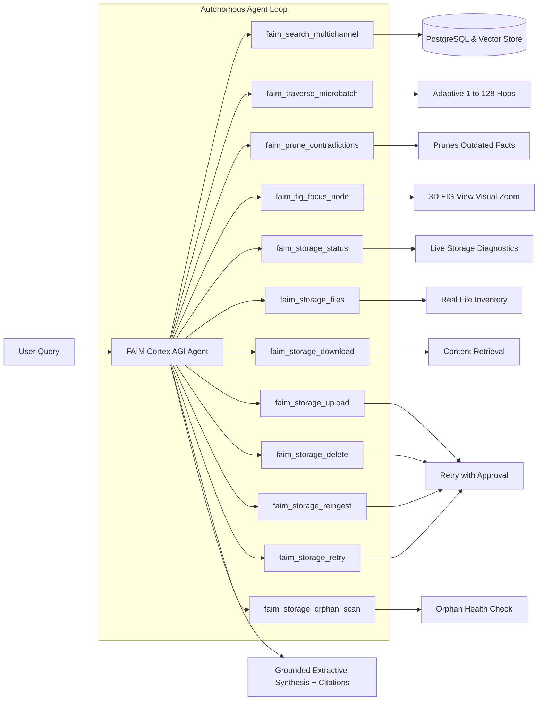

# FAIM Cortex Agent — Operational Guide

## 1. How FAIM Cortex Works Now (Under the Hood)

FAIM Cortex is an **Autonomous Cognitive Memory Agent** powered by the `cortexagi` engine:



**Core Cognitive Tools (always available):**
1. **Adaptive Hops (1 to 128 Hops)**: Simple queries use 1–2 hops; complex research expands up to 128 hops until complete evidence gathered.
2. **Deterministic Grounding**: Every claim tied to source files, page anchors, SHA-256 evidence node hashes.
3. **Temporal Contradiction Pruning**: Outdated rules flagged `HISTORICAL`; active facts marked `CURRENT`.
4. **Real-time Storage Control (NEW)**: Cortex has full access to storage operations — status, file inventory, downloads, uploads, delete, reingest, retry — all gated by human-in-the-loop approval.

---

## 2. What You See on Screen

| Component | What Appears & What You Can Do |
| :-------- | :----------------------------- |
| **Main Chat Window** | Clean markdown responses with inline citations `[spec.md · p.4]`, temporal status indicators (`CURRENT` vs `HISTORICAL`). |
| **3D FIG View Canvas** | Interactive 3D visual graph; camera auto-zooms to active memory node clusters as Cortex answers. |
| **Chat Composer Bar** | 5 Answer Mode Toggles: `CORTEX AUTO`, `DIRECT`, `TIMELINE`, `CONTRADICTION`, `PROVENANCE`. |
| **Right History Sidebar** | Session Memory: persisted Cortex sessions. Always-visible Trash Icons: delete any session from local state & DB. Active Turn Trail: expandable recent reasoning steps. |
| **Cortex Tool Approvals (NEW)** | Pending approval requests for storage mutations (upload/delete/reingest/retry) appear with approve/reject actions. Operator sees full context before deciding. |

---

## 3. Storage Tools with Human-in-the-Loop Approval

Cortex agents can now perform **all storage operations** but mutating actions require human approval:

| Tool | Purpose | Approval Required |
| :--- | :------ | :---------------- |
| `faim_storage_status` | Live storage summary: file counts, sizes, ingest health, orphan scan | ❌ No (read-only) |
| `faim_storage_files` | List catalogued files with ingest status, node/vector counts, errors | ❌ No (read-only) |
| `faim_storage_download` | Retrieve file metadata and content (base64) | ❌ No (read-only) |
| `faim_storage_orphan_scan` | Scan for orphaned edges/coactivations needing sweep | ❌ No (read-only) |
| `faim_storage_upload` | Upload file with profile `strict` / persist mode `relaxed` (or default) | ✅ Yes |
| `faim_storage_delete` | Hard delete: raw blob + graph artifacts (edges, coactivations, reprs, nodes) | ✅ Yes |
| `faim_storage_reingest` | Re-run ingest pipeline on existing raw file | ✅ Yes |
| `faim_storage_retry` | Clear delete flag and re-ingest a previously failed file | ✅ Yes |

**Approval Flow:**
1. Agent proposes action → `POST /api/v1/cortex/tool-approvals/propose` creates pending request
2. Operator reviews via `GET /api/v1/cortex/tool-approvals`
3. Operator approves → `POST /api/v1/cortex/tool-approvals/{id}/approve` executes action
4. Operator rejects → `POST /api/v1/cortex/tool-approvals/{id}/reject` skips action
5. Receipt stored in `cortex_tool_approvals` table with execution status

**Upload Parameters (per docs requirement):**
- `profile`: `strict` (default) — full extraction + semantics
- `persist_mode`: `relaxed` (default) — async durability
- Content provided as base64-encoded bytes

---

## 4. Fractal Math λ Gates Evolution

The fractal physics engine computes **λ (evolution pressure)** from first principles:

```
λ = w₀·N + w₁·(1−R) + w₂·H
```
- **N (Novelty)**: Mean residual (1 − inheritance fit) — higher = more novel content
- **R (Redundancy)**: Fraction of pairs with similarity > 0.9 — higher = more redundancy
- **H (Entropy)**: Normalized Shannon entropy of similarity distribution — higher = more diverse

**λ now operationally gates evolution:**
- `self_evolve_lambda_gate_enabled` (default `false`): when `true`, evolution skips if `λ < self_evolve_lambda_gate_min` (default 0.05)
- `self_evolve_lambda_action_scale` (default `false`): when `true`, `max_actions` scaled by `0.5 + λ` (range [0.5, 1.5])

This makes the evolution cycle **self-regulating**: low pressure (stable memory) → fewer/no actions; high pressure (novel/chaotic) → more aggressive consolidation.

---

## 5. Operational Scenarios

### Scenario A: Simple Quick Questions
- **Example**: *"What port does faim-api run on?"*
- **Cortex**: 1–2 adaptive hops, sub-second answer with exact config citation.

### Scenario B: Complex Multi-Document Research
- **Example**: *"How did security compliance guidelines evolve 2024→2026 across all design docs?"*
- **Cortex**: Multi-step adaptive hops, connects multi-step relationships, cites exact pages.

### Scenario C: Finding & Resolving Contradictions
- **Action**: Select **CONTRADICTION** answer mode.
- **Example**: *"Are there conflicting budget figures in Q3 and Q4 reports?"*
- **Cortex**: Surfaces both statements, highlights clusters in 3D FIG View, tags Q3 `HISTORICAL`, Q4 `CURRENT`.

### Scenario D: Reconstructing Chronological History
- **Action**: Select **TIMELINE** answer mode.
- **Example**: *"Reconstruct timeline of database migration project."*
- **Cortex**: Chronologically ordered event sequence from commit logs and timestamps.

### Scenario E: Cryptographic Audit & Provenance
- **Action**: Select **PROVENANCE** answer mode.
- **Example**: *"Full evidence proof for data retention policy."*
- **Cortex**: Full evidence trail with raw file IDs, section headers, block types, SHA-256 hashes.

### Scenario F: Managing Memory Sessions
- **Action**: Cortex Brain Sidebar.
- Switch between past conversations, delete sessions (DB + local), purge all local sessions.

### Scenario G: Storage Operations with Human Approval (NEW)
- **Upload**: Attach file in chat → Cortex proposes upload with profile/persist → operator approves → file ingested
- **Delete**: Cortex proposes hard delete (purges graph artifacts) → operator approves → file + orphans removed
- **Reingest/Retry**: Cortex proposes re-ingest of failed/stale file → operator approves → pipeline re-runs
- **Status**: Ask Cortex *"What's the storage health?"* → real-time summary with orphan counts, ingest status
- **All mutations** visible in approval ledger with operator decision trail

---

## 6. Key Endpoints (for integration)

| Endpoint | Purpose |
| :--- | :--- |
| `POST /api/v1/cortex/tool-approvals/propose` | Agent proposes mutating storage action |
| `GET /api/v1/cortex/tool-approvals` | List pending/approved/rejected approvals (tenant-scoped) |
| `POST /api/v1/cortex/tool-approvals/{id}/approve` | Approve and execute action |
| `POST /api/v1/cortex/tool-approvals/{id}/reject` | Reject without execution |
| `GET /api/v1/cortex/storage/status` | Live storage summary (read-only) |
| `GET /api/v1/cortex/storage/orphan-scan` | Orphan artifact health check (read-only) |
| `GET /api/v1/storage/graphs` | List tenant graphs with node/edge counts |
| `WS /api/v1/cortex/ws/chat?graph_id=...` | Real-time Cortex chat over WebSocket (streams agent responses, tool calls, approvals) |
| `POST /api/v1/reasoning/feedback` | Record feedback (rating + optional correction) for reinforcement learning |
| `GET /api/v1/reasoning/learning/state` | Durable learned pattern stats + adaptive strategy recommendations |
| `GET /api/v1/evolve/theories?graph_id=...` | List generated cognitive theories (correlation/redundancy/hierarchy/composition) |

---

## 7. Safety & Tenant Isolation

- All storage tools are **tenant-scoped**: queries filtered by `tenant_id` + `graph_id`.
- Approval ledger (`cortex_tool_approvals`) is tenant-isolated.
- Human-in-the-loop required for all mutating storage actions.
- λ-gate prevents runaway evolution when memory is stable.
- Config knobs default to conservative (gate disabled, no action scaling).

## 8. Durable Learning, Theory Generation & Synthesis Invention

The self-improvement loop now closes three ways, all durable and tenant-isolated:

- **Reinforcement learning**: Every Cortex turn can receive feedback (`POST /reasoning/feedback`). Once a pattern has ≥3 samples, its stats (average rating, correction rate, reliability score) are persisted to `reinforcement_pattern_stats` and surfaced through `GET /reasoning/learning/state`, which also returns adaptive strategy recommendations (e.g. raise confidence thresholds when ratings are low).
- **Theory generation**: During self-evolution (STEP 2c), the system derives cognitive theories — cross-galaxy concept correlation, redundancy clusters, hierarchy composition, and cognitive composition — that relate nodes across galaxies. Theories are λ-gated, bounded per cycle, idempotent, and stored in `graph_theories` (queryable via `GET /evolve/theories`).
- **Synthesis invention bridge**: Cross-galaxy synthesis insights (shared concepts observed in ≥2 galaxies with confidence ≥ 0.6) feed the self-invention engine, which invents new macros to represent the synthesized concept. This is STEP 7b of `evolve_once`, gated by `synthesis_bridge_enabled` and bounded by `synthesis_max_macros`, and emits `EVOLUTION_INVENTION_SYNTHESIS` events.