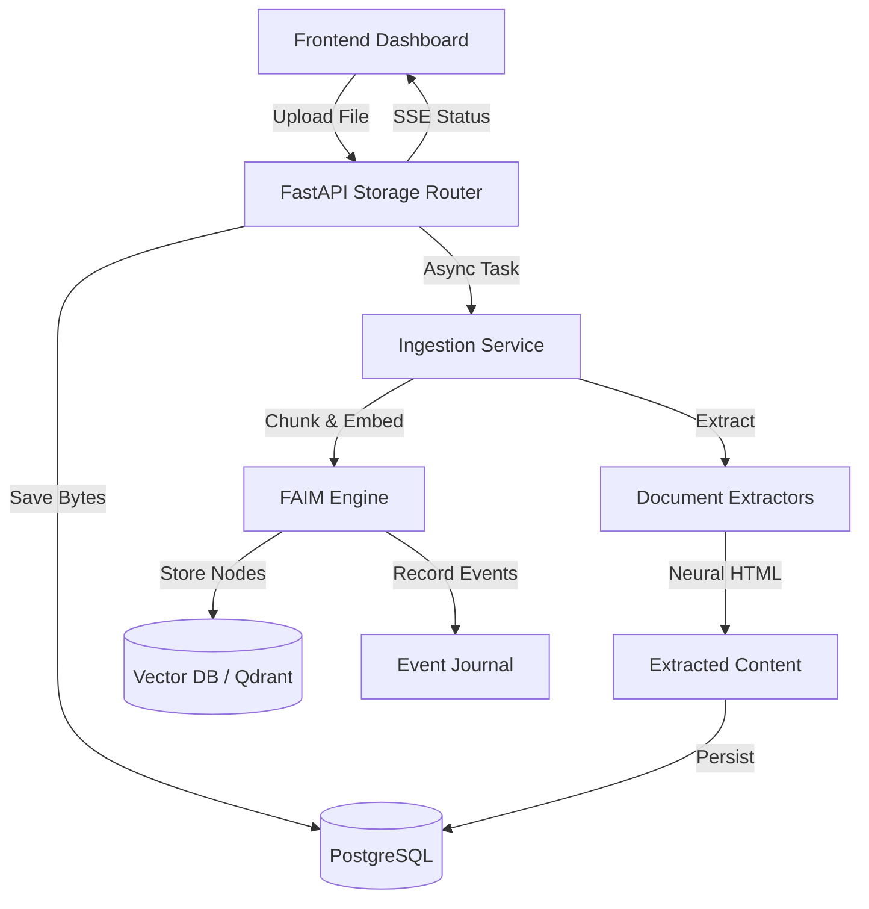

# FAIM Storage: End-to-End Walkthrough

This document provides a comprehensive deep dive into the **FAIM Storage and Knowledge Manifest** section. It covers the architecture, backend extraction logic, security layer, and a detailed guide to the UI features.

---

## 1. High-Level Architecture

The Storage section is the entry point for injecting external knowledge into the FAIM Brain. It involves a coordinated effort across the entire stack.

---

## 2. Backend: The Intelligence Engine

### 2.1 Document Extraction (`extractors.py`)

FAIM doesn't just "read text"; it understands structure.

- **PDF**: Uses `PyMuPDF` to extract text and **embedded images**. Images are base64-encoded into a custom "Neural HTML" structure.
- **DOCX**: Uses `python-docx` to recreate the document's structure (paragraphs, tables, images) in a lightweight HTML format for the in-panel viewer.
- **Plaintext/Code**: Standardized extraction with UTF-8 encoding.

### 2.2 Multi-Tenant Storage (`postgres_store.py`)

Security is built-in at the storage level.

- **Tenancy Enforcement**: Every file and every resulting memory fragment is tagged with a `user_id`. The backend automatically resolves ownership during background processing.
- **Cryptographic Isolation**: All document payloads are compressed (zlib) and encrypted using **AES-256-GCM** before hitting the disk.
- **Node Provenance**: The `documents` table stores a list of all `node_ids` it generated, allowing for complete auditability of where a specific memory came from.

---

## 3. UI Guide: Using the Storage Dashboard

### 3.1 Global Health (Top Header)

In the top-right header, you will find the **Neural Core Status**:

- **GPU Badge**: Shows "GPU ACCEL" (Amber) if the engine is using hardware acceleration, or "CPU OPTIMIZED" (Blue).
- **Throughput**: Real-time "Synapses/sec" (how fast the system is learning).
- **Stack Indicators**: Three live-pulsing dots:
  - **Emerald 1**: Redis Cache connectivity.
  - **Emerald 2**: Qdrant Vector Store health.
  - **Blue**: AES-256 Encryption active.

### 3.2 The Storage List

- **Upload Button**: Triggers the secure ingestion pipeline.
- **Status Badges**:
  - `Completed`: File is fully indexed and searchable.
  - `Neural Fragments`: Shows the count of "shards" or memories the document was broken into (e.g., `(14 chunks)`).

### 3.3 The Knowledge Manifest (Side Panel)

Clicking a file opens the side panel, which is the "mission control" for that document.

| Section             | What it is / What it does                                                                                                      |
| :------------------ | :----------------------------------------------------------------------------------------------------------------------------- |
| **Preview Window**  | **High-Fidelity Neural Viewer**. Shows text, images, and tables. No more "preview not available" for Office docs!              |
| **Neural Manifest** | Technical specs: Ingestion latency (ms), fragments created, and the protocol used (e.g., `FAIM-CORE-P4`).                      |
| **Synaptic Links**  | Shows the density of the information (how many connections these segments made).                                               |
| **Stack Health**    | A dedicated view showing the specific storage path health (Redis/Qdrant/Security) for this document.                           |
| **Activity Stream** | **Live Audit Log**. Shows the pulse of the engine. You can see exactly when the fragments were created or merged in real-time. |

---

## 4. End-to-End Life of a Document

1.  **Ingestion**: You upload `spec.docx`. The UI shows a "Processing" state.
2.  **Extraction**: The backend extracts text and visual assets (images) into the `extracted_text` column.
3.  **Neural Mapping**: The engine splits the text into chunks, generates high-dimensional vectors, and stores them in Qdrant.
4.  **Audit Recording**: Every "Add" or "Merge" event is recorded in the `journal`.
5.  **Manifest Ready**: The UI pulses. You open the file.
6.  **Inspection**: You view the images inside the panel, check the health of the encryption stack, and see the exact timeline of when FIG merged these nodes into your global knowledge graph.

---

**Status**: FAIM Storage is now **Production Mature Grade**.
