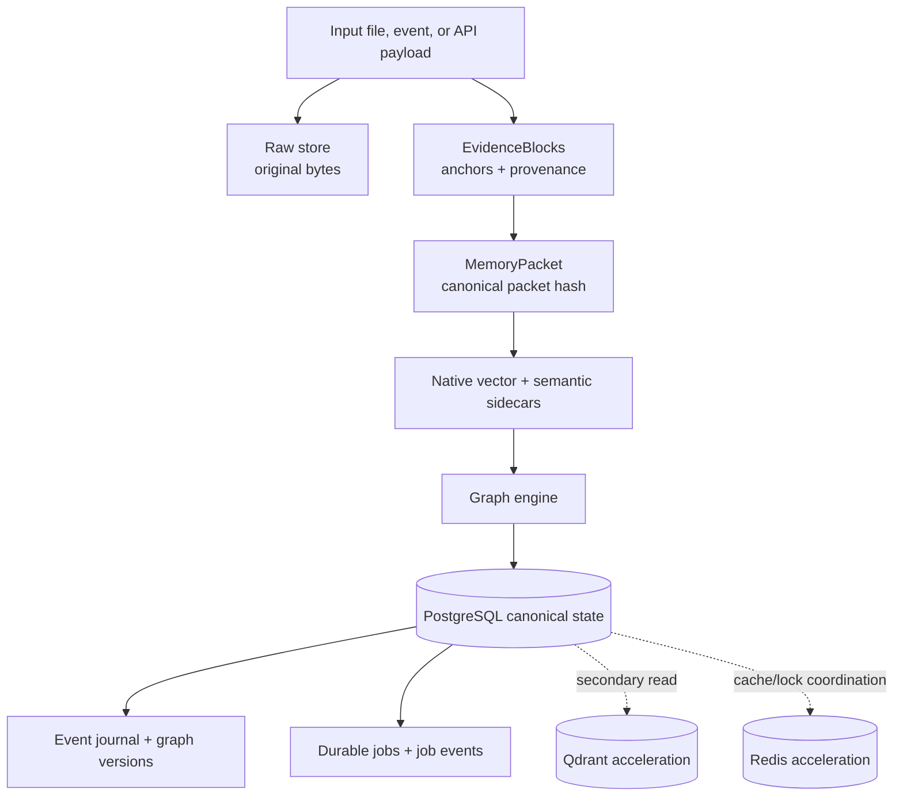
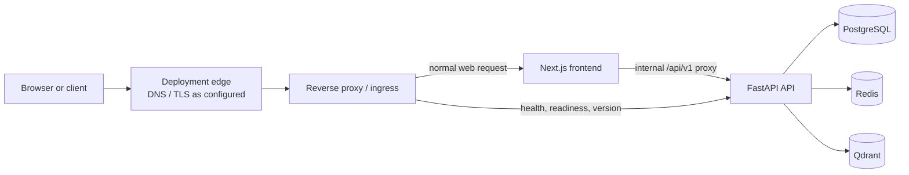
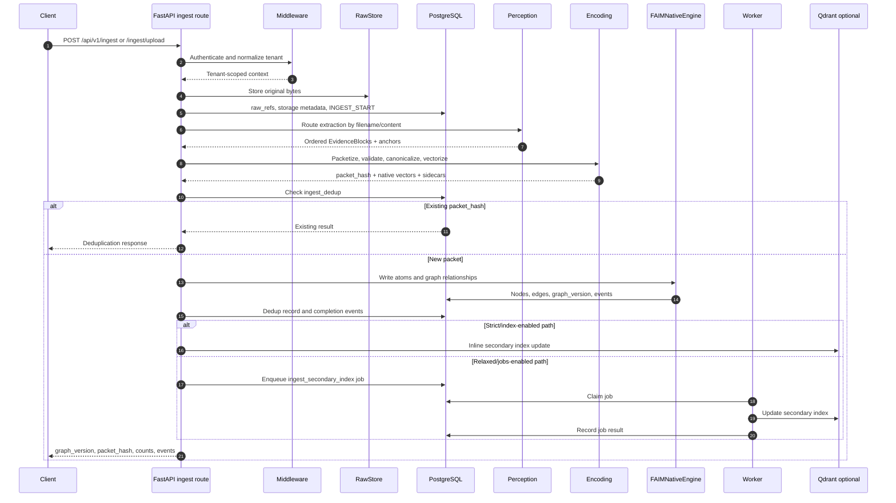
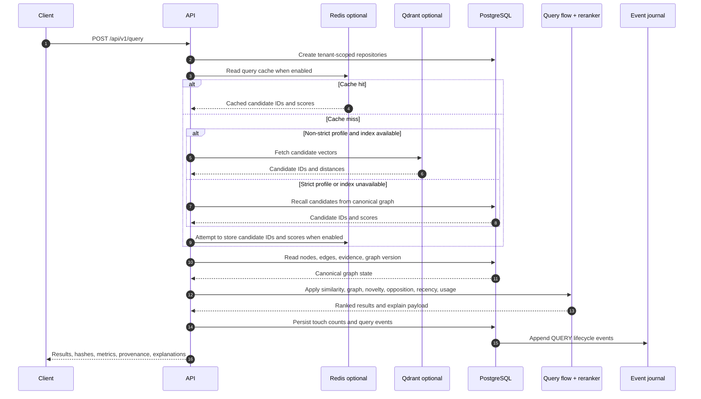
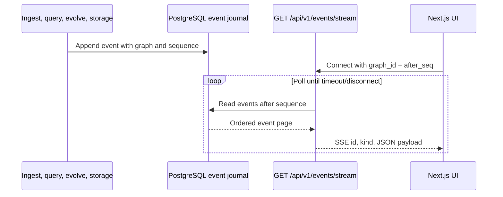

# FAIM-Native end-to-end architecture

This document is the implementation-oriented companion to the README. It describes the components that exist in the current repository, how they communicate, which data is authoritative, and where the system intentionally degrades or stops. It is not a proposal for components that are not deployed today.

## 1. Runtime component inventory

| Component | Current implementation | Communication | Durable responsibility |
| --- | --- | --- | --- |
| Browser / external client | Next.js UI or REST/WebSocket client | HTTPS, REST, SSE, WebSocket | Owns the user interaction and retry policy |
| Application edge | Deployment-provided reverse proxy or ingress | HTTP/HTTPS routing | TLS termination, security headers, compression, and edge routing as configured |
| Next.js frontend | `frontend/` | Browser plus internal API proxy | UI, auth session surface, graph/evolution/storage/provider views |
| FastAPI API | `faim_native/api/app.py` | REST, SSE, WebSocket | Authenticated request boundary and orchestration entrypoint |
| Auth middleware | JWT/NextAuth and API-key middleware | In-process request middleware | Tenant identity, scopes, rate limits, audit context |
| Perception | `faim_native/perception` | In-process ingest stages | Extracted evidence blocks and source anchors |
| Native encoding | `faim_native/encoding` | In-process ingest/query stages | Deterministic native vector and semantic sidecars |
| Graph engine | `faim_native/core` | In-process API/worker calls | Nodes, edges, inheritance, merges, versions, reasoning |
| PostgreSQL | `pgvector/pgvector:pg15` | SQL on the configured database network | Canonical graph, events, jobs, raw references, metadata |
| Raw store | `faim_native/store/raw` | Filesystem path | Original bytes, content-addressed and optionally encrypted |
| Redis | `redis:7-alpine` | Redis on the configured private network | Cache, locks, and coordination; not canonical truth |
| Qdrant | `qdrant/qdrant` | HTTP/gRPC index service | Optional secondary vector acceleration |
| Worker | `faim_native/orchestration/jobs/worker.py` | Polls PostgreSQL jobs | Evolution, maintenance, indexing, retention, re-encryption |
| Migration job | `store.pg.migrate`, one-shot Compose service | SQL to PostgreSQL | Explicit schema upgrades before application traffic |
| Backup tooling | Operator backup scripts and backup modules | SQL dump/API job plus raw archive | Recovery artifacts for database and raw files |
| Operational checks | health router, smoke scripts, structured logs | HTTP and process output | Liveness, readiness, version, pipeline and deployment evidence |

## 2. Source-of-truth rules

FAIM-Native has one canonical state path:



The important rule is that Qdrant and Redis are derived or coordination systems. If either is unavailable, the application may disable, queue, or fall back from the accelerated path depending on its profile and feature flags. A deployment must not treat either service as the only copy of memory state.

## 3. Public request path

### Hosted/containerized mode

A deployment-provided reverse proxy or ingress can terminate TLS, route `/health`, `/ready`, and `/version` to FastAPI, and send normal web requests to Next.js. PostgreSQL, Redis, Qdrant, the API, worker, frontend, and migration services remain on the configured private network unless an operator explicitly exposes a service. The frontend's internal API proxy reaches the API service through the configured service name or internal address.



### Local mode

The local Compose file maps the frontend and API to localhost ports for development. It does not include a public ingress layer, so local execution does not reproduce a hosted deployment's TLS and edge topology.

## 4. Ingestion path

An ingest request can be JSON or multipart upload. The API route creates a tenant-scoped context containing repositories, raw storage, and optional index/cache adapters.



The canonical graph write and event records are committed in PostgreSQL. The index write is a secondary durability path controlled by profile and feature flags. The response reports whether the secondary task was completed, queued, skipped, or degraded.

## 5. Query path

The query flow is graph-aware. It can use the native vector path, lexical/semantic sidecars, graph traversal, and optional Qdrant candidates. The final response is assembled from canonical PostgreSQL state.



Strict profiles can intentionally avoid the secondary index to keep ordering and writes deterministic. The exact profile policy is resolved in the running code and should be verified against the current OpenAPI contract and tests.

## 6. Background job and evolution path

The worker is not a separate message-broker consumer in the current implementation. It polls and claims durable rows from PostgreSQL. Redis can assist with locks and cache invalidation, but the job record and job events remain in PostgreSQL.

```mermaid
flowchart TB
    REQUEST["API / Cortex / scheduled scan"] --> CONTROL["Authenticate tenant + resolve controls"]
    CONTROL --> DIRECT["Direct guarded evolution"]
    CONTROL --> JOB["PostgreSQL jobs table"]
    JOB --> CLAIM["Worker claim"]
    CLAIM --> KIND{ "Job kind" }
    KIND --> INDEX["Secondary index"]
    KIND --> EVOLVE["Evolution / invention"]
    KIND --> STORAGE["Retention / upload / re-encryption"]
    DIRECT --> BACKUP
    EVOLVE --> BACKUP["Pre-action backup record"]
    BACKUP --> GRAPH["Graph mutation"]
    INDEX --> EVENT["Job event + journal"]
    STORAGE --> EVENT
    GRAPH --> EVENT
    EVENT --> DB[("PostgreSQL")]
    GRAPH -. invalidate .-> CACHE[("Redis cache")]
    GRAPH --> VERSION["New graph version"]
```

Evolution is guarded by feature flags, intervals, action limits, diagnostics, and backups. A completed job is not proof that an evolution policy is correct; it only proves that the configured execution path completed.

## 7. Event and UI update path

The event stream is backed by PostgreSQL, not Redis pub/sub. The SSE endpoint polls the tenant/graph event journal in sequence order, emits heartbeats, and allows clients to resume with `after_seq`.



## 8. Persistence and recovery

### Local Compose

Local Compose uses named Docker volumes:

- `postgres_data` for PostgreSQL;
- `redis_data` for Redis;
- `qdrant_data` for Qdrant; and
- `raw_data` for raw payloads.

### Containerized deployments

Containerized deployments may use named volumes or operator-managed bind mounts so data can be inspected, backed up, and restored independently of application containers. Exact paths, host details, and retention policies are deployment-specific and belong in a private operator runbook.

The backup helper captures a database backup through the running API container and archives raw files. Restore is an operator action and must be tested on a disposable copy before a real recovery.

## 9. Operational states

| State | Meaning | Expected action |
| --- | --- | --- |
| `/health` returns 200 | Process is alive | Continue to readiness and dependency checks |
| `/ready` returns 200 | Database, required tables, and migrations are ready | Traffic may be considered for the deployment under review |
| `/ready` returns 503 | Schema or canonical dependency is not ready | Stop rollout and inspect migration/database state |
| API healthy, worker unavailable | Synchronous API paths may still respond, but queued jobs can accumulate | Restore worker capacity and inspect job age/failures |
| PostgreSQL unavailable | Canonical state and event journal are unavailable | Treat the service as not ready; recover database first |
| Qdrant unavailable | Accelerated retrieval/indexing may degrade or queue | Verify profile fallback and job backlog |
| Redis unavailable | Cache/coordination paths may degrade | Verify lock and cache behavior before relaxing flags |
| Application edge unavailable | Public traffic cannot reach the stack | Restore the configured edge proxy and TLS path |

## 10. Current boundaries

The following are deliberately not represented as required components because they are not part of the current Compose runtime:

- Kafka or another external event bus;
- Kubernetes, service mesh, or autoscaling control plane;
- S3/object storage or a separate blob service;
- Prometheus/Grafana monitoring stack;
- a mandatory external LLM or hosted reasoning provider; and
- blue/green or multi-host failover.

Adding any of these would require a new operational contract, security review, failure model, cost model, and deployment documentation. The current system should therefore be described as a containerized research platform with PostgreSQL-backed canonical state and optional acceleration—not as a highly available distributed platform.

## 11. Code paths to inspect

- API assembly: [`faim_native/api/app.py`](../../api/app.py)
- Repository/context wiring: [`faim_native/runtime/context.py`](../../runtime/context.py)
- Ingest orchestration: [`faim_native/orchestration/ingest_flow.py`](../../orchestration/ingest_flow.py)
- Background worker: [`faim_native/orchestration/jobs/worker.py`](../../orchestration/jobs/worker.py)
- Local services: [`docker-compose.yml`](../../../docker-compose.yml)
- Compose services: [`docker-compose.yml`](../../../docker-compose.yml) and deployment overlays
- Health/readiness routes: [`faim_native/api/routers/health.py`](../../api/routers/health.py)
- Event stream: [`faim_native/api/routers/events.py`](../../api/routers/events.py)
- Deployment runbooks: [CI, semantic releases, and deployment](../10-operations/07-ci-and-releases.md) and environment-specific operator documentation
