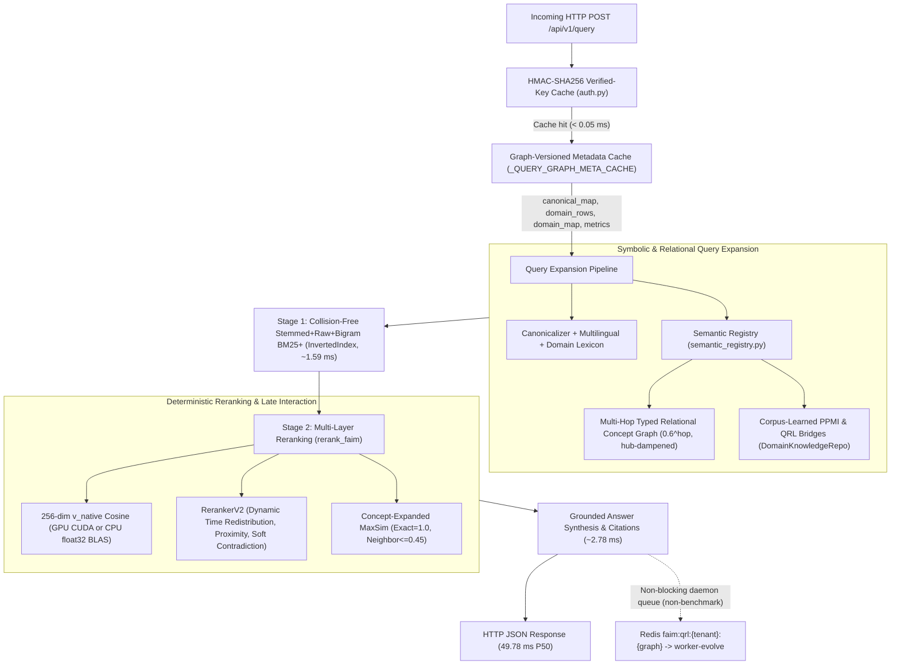
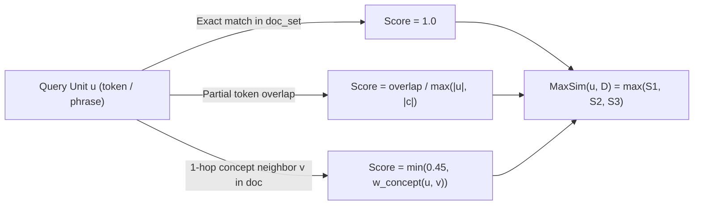

# Zero-ML Retrieval, Multi-Hop Relational Concept Graph, and Concept-Expanded MaxSim

**Scope:** Canonical technical specification of FAIM-Native's deterministic, zero-ML retrieval pipeline, hybrid CPU/GPU 256-dim matrix kernels, multi-layer reranking (`RerankerV2` + `late_interaction_native.py`), corpus-learned PPMI co-occurrence bridges, multi-hop typed relational concept spreading, and query-to-evidence reinforcement learning.

---

## 1. End-to-End Retrieval & Concept-Expansion Architecture

FAIM-Native achieves higher retrieval accuracy than both `BM25-Baseline` and standalone `Granite 97M R2` on `BeIR/scifact` (5,183 docs / 300 queries) **without loading any neural embedding model on the default hot path**.

---

## 2. Stage 1 — Collision-Free BM25+ & RAM Index Caching

### 2.1 Collision-Free `InvertedIndex` (`faim_native/index/inverted_index.py`)
Earlier versions hashed tokens into fixed buckets, causing hash collisions on technical vocabulary. The upgraded `InvertedIndex` indexes **exact stemmed tokens, raw surface tokens, and adjacent bigrams** without hash collisions and executes `score_bm25_fast` / `score_bm25_shortlist` using BM25+ ($\delta = 0.35$):

$$\text{score}_{\text{BM25+}}(q, d) = \sum_{t \in q} \text{IDF}(t) \cdot \left( \frac{f(t, d) \cdot (k_1 + 1)}{f(t, d) + k_1 \cdot \left(1 - b + b \cdot \frac{|d|}{\text{avgdl}}\right)} + \delta \right)$$

### 2.2 `GraphIndexArtifacts` RAM Metadata Cache (`faim_native/orchestration/perf/index_rebuild.py`)
Instead of issuing 20+ per-candidate SQL queries during `rerank_faim`, `build_graph_index_artifacts` caches `CachedNodeMeta` (including `v_native`, `v_embedding`, `opp_signature`, `raw_id`, `block_id`, `level`, `touch_count`, `residual`, and temporal timestamps) in RAM keyed by `(tenant_id, graph_id, graph_version, include_dense)`.

---

## 3. Stage 2 — Hybrid GPU-First / CPU-Fallback Matrix Kernels

In [`query_engine.py`](file:///home/AverQel/Projects/Projects_Science/FAIM/faim_native/core/query/query_engine.py) (`_native_cosine_sims_gpu_or_cpu`) and [`engine_native.py`](file:///home/AverQel/Projects/Projects_Science/FAIM/faim_native/core/engine_native.py) (`_matvec_gpu_or_cpu`), FAIM computes 256-dim `float32` cosine similarities and matrix-vector products using:

1. **CUDA GPU (`torch.mv` / `torch.linalg.norm`)** when `FAIM_USE_GPU_BACKEND` is `auto` or `true` and `torch.cuda.is_available()` is `True`.
2. **Automatic CPU NumPy BLAS fallback** whenever CUDA is unavailable or raises any runtime/OOM exception, preserving deterministic parity (`[1.0, 0.0, ...]`).

In [`reranker_v2.py`](file:///home/AverQel/Projects/Projects_Science/FAIM/faim_native/core/query/reranker_v2.py) and [`query_engine.py`](file:///home/AverQel/Projects/Projects_Science/FAIM/faim_native/core/query/query_engine.py):
- **Dynamic time-weight redistribution:** When a query has no temporal intent, unused temporal weight is redistributed to semantic/lexical coverage rather than penalizing timeless facts.
- **Query coverage & proximity (`_query_coverage_proximity`):** Rewards documents where query terms appear within a compact span.
- **Guarded contradiction & historical soft-suppression:** Contradictions only suppress candidates within `score_gap <= 0.25`, and `include_historical=True` applies soft-suppression instead of hard-deleting historical evidence.
- **Provenance penalty:** Non-raw derived macro nodes (`level > 0 and not raw_id`) receive a `-0.25` provenance offset so raw evidence anchors outrank ungrounded summaries.

---

## 4. Multi-Hop Typed Relational Concept Graph

**Modules:** [`faim_native/lexical/conceptnet_builder.py`](file:///home/AverQel/Projects/Projects_Science/FAIM/faim_native/lexical/conceptnet_builder.py), [`faim_native/lexical/relational_concept_graph.py`](file:///home/AverQel/Projects/Projects_Science/FAIM/faim_native/lexical/relational_concept_graph.py), [`faim_native/lexical/semantic_registry.py`](file:///home/AverQel/Projects/Projects_Science/FAIM/faim_native/lexical/semantic_registry.py)

To handle multi-hop causal and part-of reasoning without any hard-coded examples or neural models:

1. **Typed Edge Weights (`TYPED_RELATION_WEIGHTS`):**
   - `Synonym`: `0.95` | `Canonical`: `0.92` | `FormOf`: `0.90` | `DomainBridge`: `0.88`
   - `Causes`: `0.85` | `HasPrerequisite`: `0.85` | `PartOf`: `0.80` | `UsedFor`: `0.80`
   - `IsA`: `0.75` | `CapableOf`: `0.75` | `AtLocation`: `0.70` | `RelatedTo`: `0.65`
2. **Bounded Hub-Dampened Multi-Hop Activation (`spread_relational_concepts`):**
   For hop $h$ along edge $(u \to v, r)$ with out-degree $d(u)$:

   $$\text{score}(v) = \text{score}(u) \cdot \gamma \cdot w_r \cdot \frac{1}{\max\left(1.0,\; \frac{\log_2(2 + d(u))}{2}\right)}$$

   - Default $\gamma = 0.6$ (`FAIM_RELATIONAL_HOP_DECAY`), `max_hops = 3` (`FAIM_RELATIONAL_MAX_HOPS`), `beam_width = 32`, with cycle prevention and sub-millisecond execution (`< 1 ms`).
   - Merges tenant-learned `domain_map` (including PPMI and QRL bridges), `canonical_map`, `conceptnet_relations.json.gz`, and `conceptnet_synonyms.json.gz`.

---

## 5. Concept-Expanded MaxSim (`late_interaction_native.py`)

**Modules:** [`faim_native/core/query/late_interaction_native.py`](file:///home/AverQel/Projects/Projects_Science/FAIM/faim_native/core/query/late_interaction_native.py), [`faim_native/core/query/query_engine.py`](file:///home/AverQel/Projects/Projects_Science/FAIM/faim_native/core/query/query_engine.py)

- `build_query_concept_neighbors` precomputes 1-hop typed concept neighbors **once per query** before scoring candidates in `rerank_faim`.
- **Ranking invariant:** Exact surface matches always score `1.0`, whereas concept-expanded matches are strictly capped at `<= decay` (`0.45` default) and tagged as `concept:<neighbor_term>` in explain payloads.
- Pre-indexed `frozenset` lookups (`_DOC_UNITS_CACHE`, LRU max 8,192 by `repr_hash`) keep `MaxSim` fast while preserving deterministic explainability.

---

## 6. Configuration Reference

| Environment Variable | Default | Purpose |
| :--- | :--- | :--- |
| `FAIM_FAST_RELEVANCE_FIRST` | `true` | Enables relevance-first BM25+ shortlist + `RerankerV2` + `MaxSim` |
| `FAIM_FAST_ML_EMBEDDING` | `false` | Keeps `FAST` pure zero-ML by default; `true` enables hybrid Granite/BGE-M3 |
| `FAIM_USE_GPU_BACKEND` | `auto` | Uses CUDA for 256-dim native kernels & `VectorBank` when available, else CPU |
| `FAIM_RELATIONAL_MAX_HOPS` | `3` | Maximum spreading hops in `relational_concept_graph.py` |
| `FAIM_RELATIONAL_HOP_DECAY` | `0.6` | Per-hop decay factor in `relational_concept_graph.py` |
| `FAIM_MAXSIM_CONCEPT_EXPANSION` | `true` | Enables 1-hop concept-neighbor matching (`<= 0.45`) in `MaxSim` |
