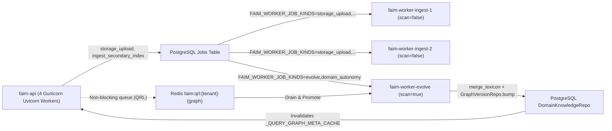
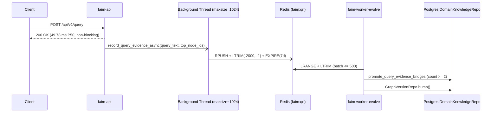

# Autonomous Learning, PPMI Bridges, Query Reinforcement, and Worker Isolation

**Scope:** Technical specification of FAIM-Native's background learning loops: **Corpus-Learned PPMI & 2nd-Order Co-Occurrence Bridges** ([`cooccurrence_bridge.py`](../../lexical/cooccurrence_bridge.py)), **Query-to-Evidence Reinforcement Learning** ([`query_reinforcement.py`](../../orchestration/query_reinforcement.py)), and **Isolated Worker Pools** ([`worker.py`](../../orchestration/jobs/worker.py), [`docker-compose.yml`](../../../docker-compose.yml)).

---

## 1. Worker Pool Isolation Architecture

Previously, a single `faim-worker` container handled both synchronous user uploads (`storage_upload`) and heavy background `evolve` / `domain_autonomy` jobs, causing head-of-line blocking during bulk ingestion and benchmarks.

### Worker Role Controls ([`faim_native/orchestration/jobs/worker.py`](../../orchestration/jobs/worker.py))
- `FAIM_WORKER_JOB_KINDS`: Comma-separated allowlist of job kinds claimed by that worker pool:
  - `worker-ingest` (`replicas: 2`): `storage_upload,ingest_secondary_index,crypto_rotation,storage_retention,raw_reencryption`
  - `worker-evolve` (`1` replica): `evolve,domain_autonomy`
- `FAIM_WORKER_SELF_EVOLVE_SCAN_ENABLED`: `"false"` on `worker-ingest`, `"true"` on `worker-evolve` so only the evolution pool runs periodic tenant scans.
- `FAIM_BENCHMARK_MODE=true`: Automatically strips `evolve` and `domain_autonomy` from `executable_job_kinds` so benchmark runs measure clean retrieval/ingest without background evolution contention.

---

## 2. Corpus-Learned PPMI & 2nd-Order Co-Occurrence Bridge

**Module:** [`faim_native/lexical/cooccurrence_bridge.py`](../../lexical/cooccurrence_bridge.py)  
**Triggers:** `run_evolve` ([`evolve_flow.py`](../../orchestration/evolve_flow.py)) and `run_domain_autonomy_now` ([`domain_autonomy.py`](../../orchestration/domain_autonomy.py)).

### Mathematical Formulation (Zero Hard-Coded Terms)
1. **Concept Extraction (`extract_concept_terms`):** Extracts non-stopword content unigrams (`len >= 3`, non-numeric) and adjacent 2-gram phrases from `NodeRepresentationV2Model.normalized_text` (up to `max_vocab = 4096`).
2. **Smoothed Shifted PPMI:** For term pair $(u, v)$ co-occurring in $C(u, v)$ documents across $D$ total documents:

   $$\text{PPMI}(u, v) = \max\left(0,\; \log_2 \frac{C(u, v) \cdot (D + 1)}{\text{df}(u) \cdot \text{df}(v)} - \log_2 k_{\text{shift}}\right)$$

   Each term vector $M[u]$ is $L_2$-normalized to $\hat{M}[u]$. When $D \ge 20$, ultra-generic terms with $\text{df}(v) > 0.70 \cdot D$ are excluded as bridge pivots.
3. **2nd-Order Distributional Cosine Similarity:** Terms $a$ and $b$ that **never appeared in the same document** ($C(a, b) = 0$) are connected through shared high-PPMI context pivots $z$:

   $$\text{sim}_2(a, b) = \sum_{z \in \hat{M}[a] \cap \hat{M}[b]} \hat{M}[a, z] \cdot \hat{M}[b, z]$$

   Pairs sharing surface stems/substrings are filtered (`_shares_surface_or_stem`) so bridge capacity focuses strictly on non-obvious paraphrase/concept bridges, prioritizing cross-document (`order = 2`) links.
4. **Persistence & Cache Refresh:** Top bridges are persisted via `DomainKnowledgeRepo.merge_lexicon(..., kind="cooccurrence_bridge")` and `GraphVersionRepo.bump(...)`, automatically refreshing `_QUERY_GRAPH_META_CACHE` on the next query (`< 0.1 ms` lookup).

---

## 3. Query-to-Evidence Reinforcement Learning (QRL)

**Module:** [`faim_native/orchestration/query_reinforcement.py`](../../orchestration/query_reinforcement.py)

- **Zero Query Latency Impact:** `record_query_evidence_async` pushes to an in-process bounded queue (`maxsize=1024`, dropping newest if saturated) drained by a daemon sender thread into Redis (`RPUSH`, capped at 2,000 events, 7-day TTL). Disabled automatically when `FAIM_BENCHMARK_MODE=true`.
- **Promotion Rule:** `promote_query_evidence_bridges` maps cited `top_node_ids` back to `NodeRepresentationV2Model.normalized_text`, weights pairs by rank decay $\frac{1}{1 + 0.5 \cdot \text{rank}}$ and reward, filters trivial surface overlap, and promotes pairs with `support_count >= 2` into `DomainKnowledgeRepo` (`kind="query_reinforcement"`).

---

## 4. Evolution & Ingest Performance Guardrails

- **Bounded Evolution Matrix ([`evolution_native.py`](../../core/dynamics/evolution_native.py)):** Vectorized `float32` cosine matrix (`_vectorized_cosine_matrix`) bounded to `<= 2048` nodes per cycle so `worker-evolve` memory remains bounded.
- **Deferred Representation Stats (`defer_repr_stats` in [`ingest_flow.py`](../../orchestration/ingest_flow.py) & [`representation_repo.py`](../../store/pg/repos/representation_repo.py)):** `FAST` ingest defers per-document `GraphRepresentationStatsModel` lock/JSON rewrites, eliminating the row-lock contention that previously stalled 5,183-doc ingest.
