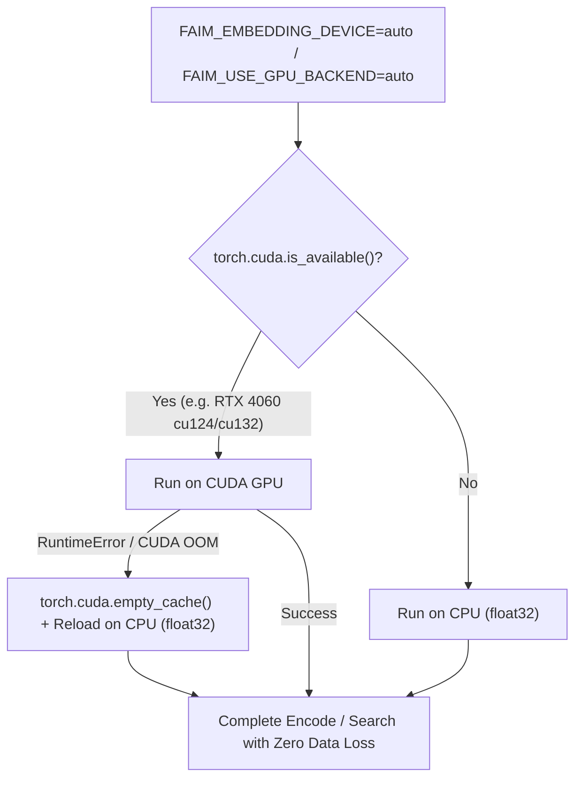

# GPU Passthrough, Automatic CPU Fallback, and HMAC Auth Caching

**Scope:** Production deployment and latency-hardening guide for [`Dockerfile`](../../../Dockerfile), [`docker-compose.yml`](../../../docker-compose.yml), [`docker-compose.gpu.yml`](../../../docker-compose.gpu.yml), GPU/CPU fallback in [`embedding_providers.py`](../../encoding/embedding_providers.py) and [`vector_bank.py`](../../orchestration/perf/vector_bank.py), and HMAC verified-key caching in [`auth.py`](../../api/middleware/auth.py).

---

## 1. Automatic GPU-First / CPU-Fallback Architecture

FAIM-Native never crashes or drops pipeline data if a GPU is missing, busy, or runs out of VRAM:



### Verified Components
1. **Embedding Providers ([`faim_native/encoding/embedding_providers.py`](../../encoding/embedding_providers.py)):**
   - `_has_sufficient_cuda_vram`: Checks `torch.cuda.mem_get_info()` against `FAIM_MIN_CUDA_FREE_MIB` (default `1024 MiB`) before allocating a CUDA context, preventing multi-worker CUDA OOM on 8 GB GPUs.
   - `_resolve_embedding_device`: Resolves `"auto"` -> `"cuda"` if CUDA is available **and** free VRAM meets `FAIM_MIN_CUDA_FREE_MIB`, else `"cpu"`; downgrades explicit `"cuda"` requests to `"cpu"` with a warning if CUDA is unavailable.
   - `_load_sentence_transformer_on_device` & `_encode_sentence_transformer_with_fallback`: Catches CUDA load/encode failures, clears CUDA cache, reloads the model on CPU with `dtype=torch.float32`, and completes `encode()` transparently.
2. **VectorBank ([`faim_native/orchestration/perf/vector_bank.py`](../../orchestration/perf/vector_bank.py)):**
   - `_use_gpu_backend()` supports `"auto"` (default) alongside explicit `"true"` / `"false"`.
   - `top_k()` and `radius()` catch any `_top_k_gpu` / `_radius_gpu` exception and fall back to `_top_k_cpu` / `_radius_cpu`.
3. **256-dim Native Kernels ([`query_engine.py`](../../core/query/query_engine.py), [`engine_native.py`](../../core/engine_native.py)):**
   - `_native_cosine_sims_gpu_or_cpu` and `_matvec_gpu_or_cpu` run on `cuda` when available and fall back to CPU NumPy on any error.

---

## 2. Docker & NVIDIA GPU Deployment

### CPU-Default Deployment (Works on Any Host)
```bash
docker compose up -d --build
```
Uses `TORCH_INDEX_URL=https://download.pytorch.org/whl/cpu` in [`Dockerfile`](../../../Dockerfile) and automatically falls back to CPU with zero errors.

### NVIDIA GPU Deployment (Fedora / Linux Host)
1. Install `nvidia-container-toolkit` and configure Docker + CDI:
   ```bash
   curl -s -L https://nvidia.github.io/libnvidia-container/stable/rpm/nvidia-container-toolkit.repo | \
     sudo tee /etc/yum.repos.d/nvidia-container-toolkit.repo
   sudo dnf install -y nvidia-container-toolkit
   sudo nvidia-ctk runtime configure --runtime=docker
   sudo nvidia-ctk cdi generate --output=/etc/cdi/nvidia.yaml
   sudo systemctl restart docker
   ```
2. Build and start with [`docker-compose.gpu.yml`](../../../docker-compose.gpu.yml):
   ```bash
   docker compose -f docker-compose.yml -f docker-compose.gpu.yml up -d --build
   ```
   Verified inside `faim-api` and `faim-worker-ingest-1` on RTX 4060 Laptop GPU (`8188 MiB`):
   `torch 2.15.0+cu132`, `cuda: True`, `_resolve_embedding_device() == 'cuda'`.

---

## 3. Short-TTL HMAC-SHA256 Verified-Key Cache & Read-Only `FAST` Path

### 3.1 Eliminating Per-Request Argon2id Latency (`~110–120 ms` Saved)
Running 64 MB Argon2id (`time_cost=3`) + a synchronous `AuthKeyAuditLog` Postgres commit on every single `/api/v1/query` request previously dominated HTTP latency (`163.49 ms` total vs `40.30 ms` engine time).

- **Implementation ([`faim_native/api/middleware/auth.py`](../../api/middleware/auth.py)):**
  - Argon2id in PostgreSQL (`TenantApiKey`) remains the canonical source of truth.
  - `_verify_db_tenant_key` hashes the incoming key with a process-ephemeral 32-byte HMAC-SHA256 secret (`_cache_digest`) and caches valid `AuthDecision(valid=True, key_id, scopes)` entries in an LRU (`max=2048`) for `FAIM_AUTH_KEY_CACHE_TTL_SECONDS` (default `60s`; `0` disables cache).
  - Plaintext API keys are **never** stored in the cache.
- **Immediate Revocation/Rotation Invalidation ([`faim_native/api/routers/api_keys.py`](../../api/routers/api_keys.py)):**
  - `rotate_api_key` and `revoke_api_key` call `invalidate_tenant_key_cache(tenant_id=ctx.tenant_id, key_id=target_key_id)` immediately upon commit.

### 3.2 Graph-Versioned Query Metadata Cache & Read-Only `FAST` Mode ([`query_flow.py`](../../orchestration/query_flow.py))
- `_QUERY_GRAPH_META_CACHE` caches `canonical_map`, `multilingual_map`, `domain_rows`, `domain_map`, and `get_graph_metrics` keyed by `(tenant_id, graph_id, graph_version)` (LRU max 256). Any write, merge, or evolution bumps `graph_version`, guaranteeing zero stale reads.
- When `fast_async_touch` is active (`FAST` profile without `FAIM_FAST_SYNC_TOUCH=true`), `emit_query_start`, `QUERY_TOUCH`, and `QUERY_COMPLETE` synchronous DB inserts are skipped, making `FAST` queries completely read-only.

---

## 4. Production Worker & VPS Sizing ([`docker-compose.yml`](../../../docker-compose.yml))

| Deployment Target | `FAIM_API_WORKERS` | `FAIM_INGEST_WORKERS` | `worker-evolve` | `FAIM_FAST_ML_EMBEDDING` | Postgres `max_connections` | Notes |
| :--- | :---: | :---: | :---: | :---: | :---: | :--- |
| **32-Core + RTX 4060 (8 GB) Local** (Compose default) | `6` | `8` | `1` | `false` (`true` w/ `FAIM_MIN_CUDA_FREE_MIB=1024`) | `300` | High-bandwidth external LLM API + bulk uploads (`2,400/min` query/memory, `1,200/min` write/ingest) |
| **4 vCPU / 8 GB RAM CPU-Only VPS** (`.env` override) | `2` | `2` | `1` | `false` (`FAIM_EMBEDDING_DEVICE=cpu`) | `300` | Keeps total RAM ~4–5 GB with ~3 GB OS/DB headroom and zero OOM |
