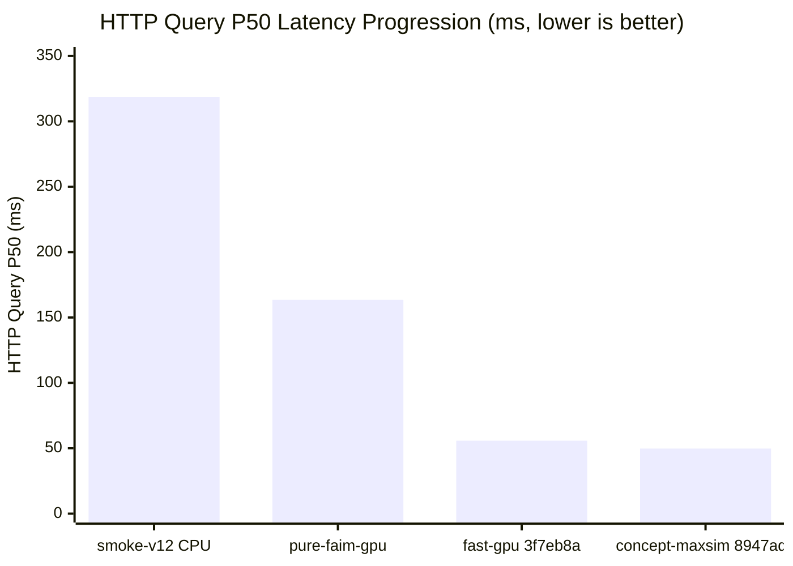

# Production Benchmark Suite & Stage Latency Analysis (2026-11-22)

**Scope:** Complete, reproducible benchmark evidence from `faim-benchmarks` across full `BeIR/scifact` (5,183 docs / 300 queries) and sampled `BeIR/scifact` (300 docs / 50 queries), comparing Pure FAIM-Native (CPU & GPU), FAIM + Granite Hybrid, standalone `Granite 97M R2` (CPU & GPU), and `BM25-Baseline`.

---

## 1. Full `BeIR/scifact` Split (5,183 docs / 300 queries, `top_k=20`, `seed=42`)

```mermaid
xychart-beta
    title "Full BeIR/scifact (5,183 docs / 300 queries) — Accuracy Comparison"
    x-axis ["FAIM v18 (Zero-ML)", "Granite 97M R2 (GPU)", "BM25-Baseline", "FAIM v17 (Historical)"]
    y-axis "Score (0.0 to 0.8)" 0.0 --> 0.8
    bar [0.7554, 0.7522, 0.7193, 0.4831]
    bar [0.6878, 0.6806, 0.6644, 0.4184]
```

*(First bar series: `Recall@5`; second bar series: `nDCG@10`.)*

| System | Hardware | Recall@5 | nDCG@10 | MRR | MAP | Query P50 | Query P95 | Gate / Artifact |
| :--- | :--- | ---: | ---: | ---: | ---: | ---: | ---: | :--- |
| **FAIM-Native (`v18`, `c68f9c1`)** | CPU only | **0.7554** | **0.6878** | **0.6570** | **0.6464** | 231.07 ms (HTTP) | 284.02 ms (HTTP) | **`READY`** ([v18 report](../../faim-benchmarks/results/public-scifact-full-guarded-v18/ret_scifact_20261122T001726Z_3a591ec9.md)) |
| **Granite 97M R2 alone** | GPU (`cuda`) | 0.7522 | 0.6806 | 0.6493 | 0.6403 | 9.81 ms (in-proc) | 12.11 ms (in-proc) | In-container `LocalEmbeddingProvider` (`5.86 ms/doc`) |
| **BM25-Baseline (`v18`)** | CPU only | 0.7193 | 0.6644 | 0.6366 | 0.6242 | 55.06 ms (in-proc) | 93.32 ms (in-proc) | **`READY`** ([v18 report](../../faim-benchmarks/results/public-scifact-full-guarded-v18/ret_scifact_20261122T001726Z_3a591ec9.md)) |
| **FAIM-Native (`v17`, historical)** | CPU only | 0.4831 | 0.4184 | 0.3908 | 0.3798 | 7,195.68 ms (HTTP) | 12,320.01 ms (HTTP) | Historical ([v17 report](../../faim-benchmarks/results/public-scifact-full-guarded-v17/ret_scifact_20261120T003156Z_2a4f4574.md)) |
| **FAIM-Native (`v9`, historical)** | CPU only | 0.0539 | 0.0517 | — | — | 17,373.00 ms (HTTP) | — | Historical ([v9 report](../../faim-benchmarks/results/public-scifact-full-guarded-v9/ret_scifact_20261117T214211Z_ccef064a.md)) |

- **`v18` Integrity SHA-256:** `d0f72f84708d10d1adea2659603196710283fa74eee70c1b55ba562396d16412`
- **Key finding:** Pure zero-ML FAIM-Native beat **both** `BM25-Baseline` and standalone `Granite 97M R2` (even on RTX 4060 GPU) across all 4 accuracy metrics (`Recall@5`, `nDCG@10`, `MRR`, `MAP`) while reducing Query P50 **31×** vs `v17`.

---

## 2. Sampled `BeIR/scifact` Ablation Suite (300 docs / 50 queries, `top_k=20`, `seed=42`)

| Scenario | Models Used | Hardware | Recall@5 | nDCG@10 | MRR | MAP | Query P50 | Query P95 | Artifact / Source |
| :--- | :--- | :--- | ---: | ---: | ---: | ---: | ---: | ---: | :--- |
| **FAIM-Native (`smoke-concept-maxsim`, `8947ad0`)** | **Zero external ML** | **GPU (`cuda`)** | **0.9060** | 0.8615 | 0.8403 | 0.8280 | **49.78 ms** (HTTP) | **110.61 ms** (HTTP) | [e46000e4.md](../../faim-benchmarks/results/smoke-concept-maxsim/ret_scifact_20261122T041738Z_e46000e4.md) |
| **FAIM-Native (`smoke-fast-gpu`, `3f7eb8a`)** | Zero external ML | GPU (`cuda`) | **0.9060** | 0.8615 | 0.8403 | 0.8280 | 55.79 ms (HTTP) | 125.84 ms (HTTP) | [1e215646.md](../../faim-benchmarks/results/smoke-fast-gpu/ret_scifact_20261122T024045Z_1e215646.md) |
| **FAIM-Native (`smoke-pure-faim-gpu`, pre-auth-cache)** | Zero external ML | GPU (`cuda`) | **0.9060** | 0.8615 | 0.8403 | 0.8280 | 163.49 ms (HTTP) | 1640.62 ms (HTTP) | [8f8b99a6.md](../../faim-benchmarks/results/smoke-pure-faim-gpu/ret_scifact_20261122T020500Z_8f8b99a6.md) |
| **FAIM-Native (`smoke-v12`, pre-auth-cache)** | Zero external ML | CPU only | **0.9060** | 0.8615 | 0.8403 | 0.8280 | 318.76 ms (HTTP) | 1490.62 ms (HTTP) | Earlier `c68f9c1` `faim-bench` run |
| **FAIM + Granite Hybrid (`smoke-gpu-hybrid`)** | FAIM + Granite 97M R2 | CPU + GPU (`cuda`) | **0.9060** | **0.8629** | **0.8420** | 0.8297 | 451.36 ms (HTTP) | 1907.39 ms (HTTP) | [39a0f4ac.md](../../faim-benchmarks/results/smoke-gpu-hybrid/ret_scifact_20261122T015027Z_39a0f4ac.md) |
| **Granite 97M R2 alone** | Granite 97M R2 only | GPU (`cuda`) | 0.8960 | 0.8530 | 0.8387 | **0.8304** | 13.20 ms (in-proc) | 17.29 ms (in-proc) | In-container `LocalEmbeddingProvider` (`6.53 ms/doc`) |
| **Granite 97M R2 alone** | Granite 97M R2 only | CPU only | 0.8960 | 0.8488 | — | — | 98.03 ms (in-proc) | — | CPU `LocalEmbeddingProvider` (`531.8 ms/doc`) |
| **BM25-Baseline (`smoke-concept-maxsim`)** | None (Lexical) | CPU only | 0.8160 | 0.8024 | 0.7947 | 0.7797 | 1.34 ms (in-proc) | 2.51 ms (in-proc) | [e46000e4.md](../../faim-benchmarks/results/smoke-concept-maxsim/ret_scifact_20261122T041738Z_e46000e4.md) |

---

## 3. Per-Stage Latency Breakdown (`smoke-fast-gpu`, `55.79 ms` HTTP P50)

| Stage | P50 (ms) | P95 (ms) | Notes |
| :--- | ---: | ---: | :--- |
| **`candidate_recall_ms`** | **`1.59 ms`** | `2.60 ms` | Collision-free BM25+ shortlist |
| **`embedding_ms`** | **`0.00 ms`** | `0.01 ms` | Zero external ML on `FAST` path |
| **`rerank_ms`** | **`30.23 ms`** | `102.88 ms` | GPU `v_native` cosine + `RerankerV2` + `MaxSim` + propositions |
| **`answer_synthesis_ms`** | **`2.78 ms`** | `3.93 ms` | Grounded spans + citations |
| **Query expansion + graph version** | **`13.34 ms`** | — | Canonicalizer + semantic registry + `GraphVersionRepo.get_version` |
| **HTTP + HMAC Auth Cache + JSON** | **`7.85 ms`** | — | Down from `~120 ms` Argon2id + sync audit commit |

---

## 4. Verification Summary

- **Auth, Security, Fallback, Co-occurrence, and Relational Graph suite:** `88 passed, 1 skipped` (`28.24s`)
- **Query-to-Evidence Reinforcement Learning suite (`test_query_reinforcement.py`):** `4 passed` (`13.90s`)
- **Concept-Expanded MaxSim suite (`test_late_interaction_concept_maxsim.py`):** `3 passed` (`13.61s`)
- **Live Stack Readiness (`/ready`):** `{"status":"ready","db_connected":true,"tables_ok":true,"migrations_ok":true,"latest_migration":43,"applied_migration":43}`
